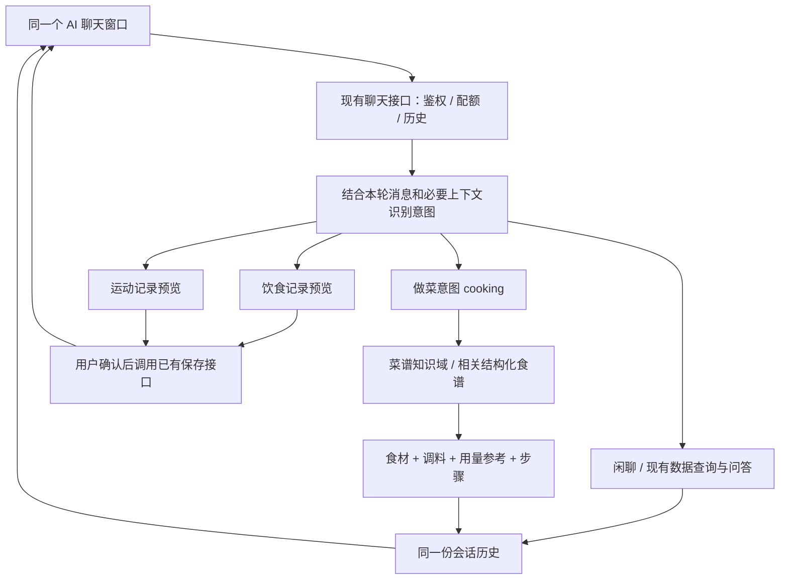

# 统一 AI 聊天接入做菜能力：改进文档

版本：1.0；日期：2026-11-19（Asia/Shanghai）。状态：设计，尚未实施或验收。

## 1. 本次设计决定

在现有聊天上增加做菜意图和菜谱知识域。用户始终在同一个聊天窗口表达需求，由后端区分闲聊/问答、饮食记录、运动记录和做菜。不另建一套“私人厨师产品”、独立聊天历史或前置表单。

用户视角：

| 用户说的话 | 系统应该做什么 |
|---|---|
| 你好、今天心情不错 | 日常对话 |
| 今天还能吃多少、鸡蛋热量多少 | 保留现有个人数据查询与营养问答 |
| 中午吃了 200 克米饭 | 识别已发生的饮食，出确认卡，确认后保存 |
| 刚跑步 30 分钟 | 识别已完成运动，出确认卡，确认后保存 |
| 红烧肉怎么做 | 查菜谱，说明食材、调料和做法 |
| 有辣椒、五花肉、鸡腿，能做什么 | 推荐相关菜，并给各自用料、调料和步骤 |
| 就做第二道，没有生抽 | 根据当前对话继续指导，不另开会话 |

“多一个意图、多一类知识库”是核心方向；实现还需要同步更新分类白名单、路由、领域检索、提示词与回归测试，不能只改提示词或导入资料就算接通。

### 1.1 与此前文档的关系

本文件替代 `CHEF_ASSISTANT_DEVELOPMENT_PLAN.md` 中的**独立厨师页面/会话/新会话接口**方案；该文档中用料完整、调料单列、约束继承等要求仍可参考，冲突时以本文件为准。

`CHEF_CODE_REVIEW_2026-11-19.md` 保留当时审查事实，不能当作本轮已修复证明。旧周计划、采购、库存扣减、调整与复盘退出本轮范围。已有基础业务与数据保留，本轮不清理文件、不改代码。

### 1.2 实际工作区

- 后端：`J:\develope\橘子rag\orangeDiary-ai`。
- 前端：`J:\develope\橘子rag\orange-diary-web`。
- 参考项目：`J:\develope\智能厨师\lc-course-main\lc-course-main`。
- 保持单 Python/FastAPI 后端；不启动参考项目作为第二个运行服务，不引入其 SQLite 会话或独立向量库。

## 2. 当前代码基线（本轮重新核对）

| 已有部分 | 实际位置与行为 | 本轮用法 |
|---|---|---|
| 统一聊天 API | `app/api/ai.py`：`POST /api/ai/chat`、`POST /api/ai/chat/stream` | 保留接口路径 |
| 聊天编排 | `app/services/ai_service.py`：AiChatService | 新增 cooking 分流，非流式/流式一致 |
| 意图识别 | `intent_classifier.py`：规则优先、模型兜底；`intent_router.py`：规则及槽位；`intent_validator.py`：白名单与规范化 | 一起扩展，不能漏掉校验层 |
| 分类提示词 | `app/prompts/intent_prompt.py` | 当前无 cooking；加入意图区分与例子 |
| 会话历史 | `ai_conversation.py`：服务端按账号派生默认 conversationId，MySQL 存历史与摘要 | 做菜继续使用同一会话，不产生第二来源 |
| 记录确认 | AiChatService 的 `_build_response`、`_diet_preview`、`_exercise_preview`；前端 applyAction | 保留确认后写入，不给做菜开放写工具 |
| 既有 RAG | `knowledge_client.py`、`app/rag/runtime.py`、`service.py` | 扩展资料域隔离，不重建整套检索 |
| 查询改写 | `query_rewriter.py` 与 `_history_lines` | 消解“这道、第二道”等，但保留用户原话 |
| 现有厨师服务 | `chef_service.py`、`recipe_service.py`、chef 场景提示词 | 选择性复用检索/做法组织，修复无关回退，不能直接嵌套调用再落一次历史 |
| 前端聊天 | `AiChatView.vue`、`api/ai.js` | 保留主题、SSE、历史恢复与确认卡 |

当前的细粒度意图还包含 daily_summary、diet_detail、food_nutrition 等，不应粗暴删除，重新变成只有三个标签。对用户是几个场景，对后端仍需要细分准确路由。

已知差异：`knowledge_client.search` 当前没有 domain 参数；`RetrievalService.search` 也没有按领域过滤的搜索参数。`runtime.py` 当前缓存一套检索实例，不能通过每次更换全局 Settings/collection 来切换知识库，否则会反复关闭和重建运行时。这些都属于待改内容。

## 3. 目标主链路

新增的是聊天内部的一条处理分支，不要求用户自己选择工作流。不新增厨师 sessionId，不从浏览器上传拼接的历史，不额外维护一份做菜对话数据库。

## 4. 意图设计与边界

### 4.1 新增 cooking 意图

一个 cooking 意图足够覆盖菜名问法、食材推荐和后续烹饪追问；subtype 可为 dish/ingredients/followup，是槽位，不再拆成多套聊天入口。

建议槽位（具体命名在实施时与现有 snake_case 规范统一）：dish_name、ingredients、servings、excluded_ingredients、allergens、equipment、selected_dish、subtype。名单和数值有长度/范围限制；只提取用户明确表达或可从当前上下文可靠还原的内容。

做菜不要求 amount_g；“一块五花肉”“两个鸡腿”可以先给参考做法，不应误触发“记录饮食缺多少克”的追问。人数未给时按 2 人份参考并说明，不要求填问卷。

### 4.2 必须分开的语义

| 输入 | 预期意图/行为 |
|---|---|
| 我想吃红烧肉、红烧肉怎么做 | cooking；不能记为已吃 |
| 我有鸡腿和辣椒 | 根据上下文识别做菜需求；无上下文且含糊时简短确认 |
| 我吃了红烧肉 | food_record；缺数量走现有澄清，不能推断份量 |
| 我准备跑步 30 分钟 | 非已完成运动；不能自动记录 |
| 我刚跑完 30 分钟 | exercise_record |
| 红烧肉热量多少 | food_nutrition；不能仅看到菜名就跳到 cooking |
| 做好后放 200 克米饭 | cooking 上下文；这是做饭用量，不是已摄入 |
| 今天吃了米饭，晚上鸡腿怎么做 | 拆分记录与做菜子请求；缺参只追问记录部分，做菜可独立回答 |

规则不能只看“鸡腿、吃、分钟”这类词。先判断时间与行为是否已发生，再区分查询、烹饪和写入意图。明确切换到其他话题时结束做菜主导，不能因为上一轮在做菜就永久锁死 cooking。

现有 classify_message 只接收本轮文本，因此需要扩展**可选、受限的服务端上下文**供指代识别；上下文从同一 ConversationService 读取。不要为每次普通问候增加一次无必要的改写模型调用。复合意图不能继续被“第一个结果”或全局缺参追问截断，应在编排层明确处理各子请求。

## 5. 做菜知识库：新增资料域，复用检索基础设施

首期采用**逻辑独立的 cooking 资料域**：可在同一 Qdrant 集合和检索运行时中保存，元数据用 knowledge_domain=cooking，与现有 nutrition 资料隔离。不需要新增数据库服务器、Embedding 提供商或一个厨师进程。

### 5.1 待补的领域隔离

1. 导入 schema/manifest/payload 增加 knowledge_domain；现有文献需有明确回填规则并重新生成对应索引，不能只改代码不重建旧索引。
2. 知识客户端和服务 search 接收服务端指定 domain；厨师查 cooking，营养指南查 nutrition，不让客户端随便选内部集合。
3. 向量召回和 BM25 都必须在候选阶段按域限定，再融合/重排；不能先混搜取 Top-K，最后过滤，导致相关菜谱早已被挤掉。
4. cache key、检索统计、来源快照记录 domain 和 indexVersion，防止营养缓存命中做菜问题。
5. 导入权限、发布索引和回滚机制复用原流程；模型维度不变，不假设仅添加字段就自动修改已发布索引。

按域过滤还未实现，不能把“现有 RAG 可复用”写成“现有 RAG 已支持多知识域”。如果实施发现现有索引结构不适合统一过滤，可改为独立 collection，但要独立实例缓存/索引目录，避免全局实例来回重建；此项是备选，不是首期同时做两套。

### 5.2 菜谱资料格式与质量

每篇菜谱包含菜名/别名、人数、主料辅料、调料、参考用量、准备步骤、烹饪步骤、火候与时间参考、熟度判断、替代建议、来源与许可。缺失就标明，不因凑齐字段编造权威来源。

按菜谱标题及“材料/调料/步骤”结构切分，携带稳定 recipe_key；召回片段时按同一 recipe_key 补齐用料和步骤，避免只检索到一段“翻炒出锅”就生成完整配方。相同菜的多个片段合并，不将它们算成多道推荐。

先覆盖用户提到的菜和食材场景：辣椒炒五花肉、鸡腿常见做法、红烧肉及少量基础家常菜。当前结构化库只有样例，不能因为资料已导入就声称正式覆盖完成；沿用审查数据需在实施前重新核对数量与许可。

### 5.3 结构化食谱与 RAG 的关系

现有 RecipeService 可作精确菜名/食材匹配和份量缩放的补充；不要求为了做菜先维护库存。修复整句检索失败后取前三条无关菜的问题，不能把原 ChefService 原封不动接到聊天里。

资料缺失分开表达：no_evidence、unavailable、busy。默认可对常见菜给“通用做法建议，用量仅供参考”，不得伪造引用或营养值；不确定的做法应说明或追问。未配置联网时不得声称“搜索网络得知”。联网搜索不属于首期必需项。

## 6. 做菜回答和多轮行为

首期直接在现有聊天气泡输出文字，不强制新增卡片协议、JSON 菜单状态或独立菜谱详情页。格式如下：

1. 菜名与人数；食材模式可推荐 2–3 道，资料不足时少推。
2. 主料/辅料及参考量。
3. 调料及参考量，明确还需准备什么。用户没提到的调料只能说“需准备/请确认”，不能默认家里有。
4. 准备与按序操作步骤，包含火候、时间参考和完成判断。
5. 缺料替代、注意事项及实际使用的来源。

推荐应围绕用户食材，不强行把所有食材放进一道菜。未知的精确克重不等于不能给家常参考量，但参考量不能写成实际购买量、库存量或摄入量。每道菜的引用必须可映射到本轮检索结果；不将所有召回片段伪装为已引用来源。

“第二道”“不用辣椒”“没有生抽”从同一会话最近相关回答恢复；最近菜名、顺序、人数、过敏/忌口需要在摘要或上下文窗口中保留。当前 `_history_lines` 每条截取 200 字，不能保证保留第二道菜，实施时应补足烹饪追问所需上下文，而非再建立独立会话。

歧义时只问一个必要问题；明确新菜名视为切换，不混入旧菜步骤。已声明过敏限制在相关做菜追问中持续生效，不能因为用户说“就这样”自动消失。复杂调味料成分未知时提示确认。

## 7. 接入现有 API、SSE 与确认卡

- 继续 `POST /api/ai/chat` 和 `/api/ai/chat/stream`，请求仍可只传 message；历史仍用 `/api/ai/conversation/messages`。
- 现有 message/sources/knowledge/done/error 事件足够首期做菜正文；不新增一个不兼容 SSE 通道。需要额外展示字段时保持向后兼容。
- 按 cooking 分支选择做菜提示词：当前 `_complete/_stream_round` 固定用 diary-chat 场景，必须同时修改这两个路径，不能只新增 CHEF_PROMPT 却从未使用。
- chef 场景当前不允许 stream；实现时应新增允许流式的只读做菜场景，或在共用聊天场景中安全组合做菜策略。不能直接对当前不支持 stream 的 chef 场景发流式请求。
- Cooking 分支复用外层配额和历史落库。不要再调用一个同时扣次、创建会话和保存历史的子服务，避免双扣/双记；模型重试预算算在同一次用户请求内。
- 饮食/运动仍由现有 action 确认卡处理，用户点击保存后才调用业务写入。做菜推荐、做饭完成不自动等同于吃完，不触发任何记录写入或库存扣减。
- 非流式、流式都先决定处理分支。记录预览不应无意义调用生成模型；做菜消息不应误生成记录卡。
- 现有独立 `/assistant/chef` 若保留兼容，应复用无副作用的做菜上下文构建/生成组件；不能成为绕过统一配额的备用入口。主入口不再引导用户去独立 ChefView。

## 8. 文件级改造清单

| 模块 | 文件 | 计划修改 |
|---|---|---|
| 意图规则 | `services/intent_router.py` | cooking 规则、槽位、记录时态和多意图区分 |
| 意图协议 | `prompts/intent_prompt.py`、`services/intent_validator.py` | 新增 cooking 白名单、合法槽位及示例，禁用未知参数 |
| 上下文分类 | `services/intent_classifier.py` | 可选服务端上下文，规则与语义路径协议一致 |
| 编排 | `services/ai_service.py` | cooking 路由、领域知识注入、两种响应路径、复合请求处理 |
| 提示词与模型 | `prompts/scenarios.py`、必要的网关场景配置 | 做菜输出要求、允许的流式场景、工具权限与输出预算 |
| 检索 | `services/knowledge_client.py`、`rag/service.py`、`rag/runtime.py`、两种召回实现 | domain 参数、过滤、缓存键与索引版本隔离 |
| 数据导入 | `rag/schemas.py`、实际 ingest/index 构建脚本、manifest | 领域元数据、按菜谱组织与重建索引 |
| 菜谱复用 | `services/recipe_service.py`、`chef_service.py` | 去无关回退，份量一致；分离上下文构建与会话/模型副作用 |
| 会话 | `services/ai_conversation.py`、`query_rewriter.py` | 保留当前菜和约束，使用同一历史；按需调整上下文窗口 |
| 前端 | `views/AiChatView.vue`、`api/ai.js` | 同聊天入口补示例问题、兼容来源/状态，保留记录卡与主题 |
| 旧入口 | `DietOverviewView.vue`、`ChefView.vue`、路由 | 做菜快捷入口转入统一聊天，兼容旧链接；不删除其他业务数据 |

不因本轮新增意图就修改全部旧业务表。若需要额外持久字段，先确认现有历史/摘要与快照能否满足，再提出小迁移；不提前扩成任务调度和周计划系统。

## 9. 实施顺序

| 阶段 | 工作 | 完成判据 |
|---|---|---|
| I1 | 固定意图边界测试，增加 cooking 分类和统一分流 | 菜名/食材/追问正确路由，既有记录/营养查询不回归 |
| I2 | 导入首批菜谱，做领域隔离、召回与索引验证 | 两条召回通道均不会串域，完整菜谱可还原，无关回退消失 |
| I3 | 接入做菜提示词，复用会话、配额和 SSE | 流式/非流式一致，能连续追问，不双扣或双记 |
| I4 | 调整聊天示例与旧入口，回归混合意图与失败分支 | 同窗口完成三类交互，确认卡只在记录时出现 |
| I5 | 小批真实模型验证与用户验收 | 下述用例留下实际证据，限制明确；用户确认前不标已验收 |

首期不要求复杂卡片、图片识别、联网代理、多 Agent、私人厨师独立页面、计划/采购/库存/复盘。先把统一聊天中的文字能力做可靠。

## 10. 验收用例

| 编号 | 输入或操作 | 必须满足 |
|---|---|---|
| U01 | 你好 | 正常闲聊，不强制查菜谱或生成记录卡 |
| U02 | 今天还剩多少热量 | 使用现有账号真实汇总，不走菜谱域 |
| U03 | 我中午吃了 200 克米饭 | 出饮食确认卡，确认前不新增记录 |
| U04 | 我跑完了 30 分钟 | 出运动确认卡，缺具体运动时追问，不编造 |
| U05 | 辣椒炒五花肉怎么做 | 做菜意图；食材、调料、用量、步骤齐全 |
| U06 | 辣椒、五花肉、鸡腿能做什么 | 推荐相关菜，各道用料和做法完整，标需准备调料 |
| U07 | 就做第二道；没有生抽；不吃辣 | 同窗口正确追问，菜品和已有约束不丢 |
| U08 | 鸡腿热量多少；我想吃鸡腿；我吃了鸡腿 | 分别是营养查询、做菜/适当澄清、记录；不混淆时态 |
| U09 | 做菜讨论后“刚跑完步”；记录后“红烧肉怎么做” | 能切换意图，不粘在前一场景 |
| U10 | 今天吃了米饭，晚上鸡腿怎么做 | 拆分理解，记录缺参不阻断独立做菜回答；不擅自保存 |
| U11 | 花生过敏，多轮后改做另一道菜 | 仍遵守当前约束；来源/调味品成分不明时说明 |
| U12 | 菜谱库空、检索超时、配额用尽、模型断流 | 状态区分；通用建议标识；无假来源或无关菜凑数 |
| U13 | 相同问题分别流式、非流式；刷新查看历史 | 路由和约束一致；同一账号同一历史，无重复消息 |
| U14 | nutrition/cooking 交替查询，缓存命中 | 无跨域证据污染；追踪记录可区分领域 |
| U15 | 做菜建议后不点击任何记录按钮 | 饮食/运动表和库存不因做菜回答变化 |

验证分层：意图与路由单测 → 隔离数据库和模型桩测试 → 索引/检索域集成测试 → 前端构建与浏览器交互 → 少量真实模型对话。记录每层实际执行情况，不能用 build 通过或桩测试替代真实效果。

## 11. 当前交付状态

本轮重新核对统一聊天、意图、会话、检索、前端 SSE 和旧方案相关代码，完成本改进文档及旧文档口径指引。未实施 I1–I5、未导入菜谱、未改接口/业务逻辑、未清理文件。此前审查的构建/测试结果属于此前那次检查，本轮未重跑，不作为本新设计已验证的证据。

## 12. 实施记录（2026-11-19 起）

### 12.1 已落地：I1 意图与分流

| 改动 | 文件 | 实际行为 |
|---|---|---|
| cooking 意图 | `prompts/intent_prompt.py` | 白名单加 cooking；写明"想做/吃了/热量多少"三种时态必须分开；cooking 永不产生 missing_slots |
| 槽位校验 | `services/intent_validator.py` | 新增 dish_name/ingredients/allergens/excluded_ingredients/servings/equipment/subtype；servings 限 1–12，列表限 8 项×200 字；**cooking 不进 REQUIRED_SLOTS** |
| 规则识别 | `services/intent_router.py` | 优先级 85，低于 food_nutrition(100)/food_record(95)，无 conflict_group 以便与记录意图并存；`(?<!没)有` 避免把"没有生抽"当成已有食材 |
| 缺参不截断 | `services/ai_service.py` | 有 cooking 子请求时 `clarification_reply` 返回 None；记录缺的克数改由 `pending_record_question` 注入上下文，回答做菜后在末尾补问 |
| 做菜上下文 | `services/cooking_service.py`（新） | 结构化食谱 + 烹饪资料域；**检索不到就返回空，不拿库里前三条无关菜凑数**；未指定人数按 2 人份折算并说明 |
| 场景与流式 | `prompts/scenarios.py` | 新增 `cooking` / `cooking-stream`；两条路径都按分支选场景，做菜不传 tools |
| 知识域参数 | `services/knowledge_client.py`、`rag/runtime.py`、`rag/service.py`、`rag/retrieval/vector.py` | `search(..., domain=)` 全链路；向量侧按 `knowledge_domain` 在候选阶段过滤，BM25 按域用独立索引文件，实例按域缓存 |

验证：`tests/test_cooking_chat.py` 12 条通过；意图/聊天/R3 回归共 109 条通过。真实模型（DeepSeek）实测：
- 「红烧肉怎么做」→ 按 2 人份给量、调料"请先确认家里有"、步骤含火候与完成判断、标来源；
- 「辣椒、五花肉、鸡腿能做什么」→ 给 2 个候选，其中没有收录的明确说"资料里没有收录"，不编步骤；
- 「今天吃了米饭，晚上鸡腿怎么做」→ 先答做菜，末尾补问"米饭大约吃了多少克"，不生成记录卡。

### 12.2 与 §8 的一处有意偏离

§8 写的是"做菜快捷入口转入统一聊天，**兼容旧链接**"。经确认改为**下线入口**：`DietOverviewView` 的"智能饮食"四宫格与 `/diet/chef`、`/diet/plan`、`/diet/shopping`、`/diet/review`、`/diet/preferences` 五条路由一并删除，页面文件保留但不可达；旧地址由路由兜底重定向回 `/diet`。数据与后端接口一律保留。

### 12.3 尚未完成

| 项 | 现状 | 影响 |
|---|---|---|
| 正式食谱覆盖 | 结构化食谱 10 道 `sample`；烹饪资料域 18 道项目整理菜谱 | 距 60/100 的验收门槛还有距离，不能算"正式覆盖" |
| `ChefService` 收敛 | `/api/assistant/chef` 仍用自己的候选与提示词 | 兼容入口保留，尚未复用 `CookingService` 的上下文构建 |
| I5 小批真实模型验收 | 已跑 Q05/Q06/Q08 与营养回归 | U11–U14 未逐条留证据 |

### 12.4 已落地：I2 语料导入与领域隔离（2026-11-19）

| 改动 | 文件 | 实际行为 |
|---|---|---|
| 域元数据 | `rag/schemas.py`、`rag/ingestion/manifest.py` | `DocumentMeta/Chunk` 增 `domain` / `recipe_key` / `chunk_strategy` / `license`；清单里域名拼错直接报错，避免"两个域都查不到"的静默故障 |
| payload | `rag/schemas.py` | 每个片段带 `knowledge_domain` 与 `recipe_key`；`SCHEMA_VERSION` 升到 2，旧点因版本不符自动重建 |
| 菜谱切块 | `rag/ingestion/chunker.py` | `chunk_strategy=recipe` 时整份菜谱一个片段（食材/调料/步骤/要点全套出现）；引用块的免责说明不进索引，避免稀释语义 |
| 分域 BM25 | `rag/pipeline.py` | 一次构建产出 `bm25/<version>.json`（合并，供运维）+ `bm25/<domain>.<version>.json`（检索用）；发布清单记录每域片段数 |
| 域默认值 | `services/knowledge_client.py`、`services/ai_service.py`、`services/chef_service.py`、`api/rag.py` | 检索客户端默认 `nutrition`（不再"不限定域"）；聊天营养分支显式 nutrition，厨师/做菜分支显式 cooking，内部接口可传 `domain` |
| 共享 reranker | `rag/runtime.py`、`rag/service.py` | 跨域共用一份 rerank 模型（原先按域各建一份会把几百 MB 模型加载两遍）；服务关闭时不误关共享实例 |
| 来源与追踪 | `alembic/versions/0010_knowledge_domain.py`、`models/ai.py`、`services/ai_source_snapshot.py`、`services/ai_trace_service.py` | `ai_answer_source` / `ai_chat_trace` 增 `knowledge_domain`；来源卡片的 `sources[].domain` 一并回传 |

语料：`knowledge/sources/cooking/` 下 18 道家常菜 + 1 篇《常见食材搭配与替换》。
每份菜谱都写明"项目整理、用量为参考值、未引用外部权威来源"，`source_url` 为空、
`needs_review=true`，菜谱正文不写营养值（营养一律由食物库按克重算）。

索引：`knowledge-v4` / 集合 `orange_diary_knowledge_v4`，**168 片段**
（nutrition 144 / cooking 24）。旧 `knowledge-v3` 集合原样保留，可回滚。

验证（真实 Qdrant + bge-m3 + bge-reranker）：

- 域隔离正反向都成立：`成人每天食盐不超过多少克` 在 cooking 域 0 命中；
  `红烧肉怎么做` 在 nutrition 域 0 命中；命中片段的 `knowledge_domain` 全部与请求域一致。
- 真实模型：`红烧肉怎么做` → `knowledgeStatus=ok`，来源「红烧肉（家常焖烧）」，回答含食材/调料/步骤/替代；
  `鸡腿除了红烧还能怎么做` → 来源「红烧鸡腿」；`辣椒、五花肉、鸡腿能做什么` → 红烧肉 + 宫保鸡丁；
  营养问句来源全部 `domain=nutrition`。
- 落库：`ai_chat_trace.knowledge_domain` 与 `ai_answer_source.knowledge_domain` 分别为 cooking / nutrition。

真实链路暴露并修掉的两个问题（单测发现不了）：

1. `鸡腿除了红烧还能怎么做` 的菜名槽位被正则吞成「鸡腿除了红烧还能」→ 检索必然零命中。
   修法：菜名从句标记（除了/还能/可以/如何/怎么…）一律截断。
2. 只用菜名（「红烧肉」）去检索，信息量太少，被证据门槛判成不相关，`knowledgeStatus` 退回 no_evidence。
   修法：用用户原话检索，菜名只用于槽位与同菜过滤。
   附带：同菜过滤在「除了红烧还能怎么做」这类要替代方案的问法下会误删候选，按问法跳过过滤。

### 12.5 多轮承接与记录体验（2026-11-20 00:10）

真实链路复验「第二道怎么做」「不放辣」「没有生抽了怎么办」时暴露三类问题，均已修复：

| 问题 | 现象 | 修法 |
|---|---|---|
| 分类不看历史 | 「不放辣」3 字短句被判成闲聊，反问"你想做什么" | `classify_message(..., history=)`，语义路径拼最近几轮对话；规则命中时行为不变 |
| 追问不检索 | `CookingService.build` 对 `subtype=followup` 直接早退，"没有生抽"没有任何依据 | 补全成功（`resolved_query`）就正常检索；没补全仍沿用历史 |
| 同菜过滤误删 | 菜名从历史带进 `dish_name`，"不放辣"命中的《食材搭配与替换》被当成别的菜删光 | 只有菜名出现在**本句**才过滤 |

另外两处：
- 改写模型会擅自拼接上文（"第二道怎么做" → "红烧肉不放辣的第二道怎么做"），prompt 增加"只做指代替换"；
  仍失准时按"原句 → 本句已确认的菜名"重试两档，不把改写当唯一依据。
- 「吃了两个鸡蛋」原本反问克数，而 `food_serving` 里已有 1 个鸡蛋 = 50g：新增按份量映射换算，
  成功就直出确认卡；没有映射继续追问，不按经验值猜。中文时长（半小时/一个半小时）同样换算成分钟。

仍未做：正式食谱 60/100、图片与价格 Provider、`edible_ratio` 可食部换算、`ChefService` 收敛、I5 全量用例。

