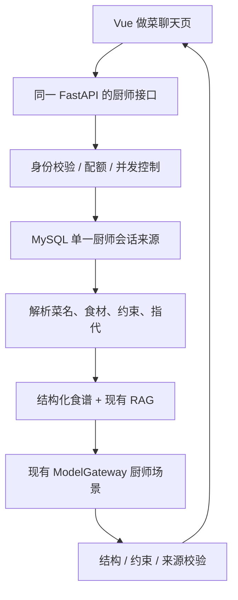

# AI 做菜助手开发文档

> 方案已调整（2026-11-19）：用户明确采用“同一聊天入口，新增做菜意图和菜谱知识域”。本文件保留前一版设计；其中独立厨师会话、新 session API、独立主页面不再作为执行要求。最新实施基线为 [统一聊天改进文档](AI_CHAT_COOKING_IMPROVEMENT_PLAN.md)，其他冲突条目同样以新文档为准。

版本：1.0；日期：2026-11-19（Asia/Shanghai）。状态：设计基线，尚未实施、尚未用户验收。

## 1. 变更说明与唯一目标

用户已将智能饮食闭环收敛为 AI 做菜助手：**说菜名，教怎么做；说几种食材，推荐能做的菜并教做法。** 每道菜都应包含食材、调料、参考用量和具体步骤，并支持“第二道”“不吃辣”“没有生抽”等连续追问。

本文件是这次改造的执行基线；事实依据见 `CHEF_CODE_REVIEW_2026-11-19.md`。旧架构文档仍用于理解迁移历史，其 R3 范围不自动带入本轮。所有“完成”必须有实际代码和验证记录，不以旧清单的完成标记替代检查。

| 原条目 | 本轮处理 |
|---|---|
| 私人厨师 | 收敛为 AI 做菜助手，是本轮核心 |
| 周计划、计划采纳、调整对比、复盘 | 退出本轮主流程和验收，不继续补齐 |
| 库存、预留、执行扣减、购买与撤销 | 不接入做菜流程，不要求用户维护 |
| 偏好问卷 | 不设前置门槛；用户可随口补充人数、忌口、厨具 |
| 采购清单 | 改成每道菜里的“还需准备”，不生成采购业务单 |
| 饮食记录、社区、认证等原有业务 | 保留，不在本轮重写或删除 |
| Java/Python 双进程、独立 SQLite 厨师服务 | 不引入；继续单一 Python 后端 |

代码目录：后端 `J:\develope\橘子rag\orangeDiary-ai`，前端 `J:\develope\橘子rag\orange-diary-web`。参考目录 `J:\develope\智能厨师\lc-course-main\lc-course-main` 仅用于理解交互与检索思想，不能复制其密钥、另起服务或引入第二套会话来源。

## 2. 用户流程

### 2.1 说菜名

用户：“红烧肉怎么做，2 人吃。”

助手围绕红烧肉输出：2 人份 → 主料/辅料 → 调料与参考量 → 备料 → 编号步骤（火候、时间、状态）→ 注意事项。不能因为库里没有红烧肉而换成番茄炒蛋。

### 2.2 说食材

用户：“有辣椒、五花肉、鸡腿。”

默认推荐 2–3 道有明显食材关联的菜，资料不足时少推并解释。每道都给完整用料、调料和可执行做法，同时区分用户明确说有的材料和仍需准备的材料。不要强迫把三种食材放进同一道菜；不得默认用户已有盐、油、生抽等调料。

### 2.3 连续追问

用户：“就做第二道，没有生抽，不吃辣。”

助手根据同一会话上一轮的有序推荐识别第二道，更新当前选中菜品、可用调料与忌口，再给适配后的做法。不可靠时只追问一个必要问题，不另起一道无关菜。明确的过敏约束不得被后续模糊消息取消；只有用户明确纠正后才能更新。

### 2.4 交互默认值

- 首屏两个快捷入口：“想吃什么菜”“这些食材能做什么”；共享一个对话输入框。
- 未说人数时默认 2 人份并写明，可直接改；不为回答一道家常菜要求先填资料表。
- “已有”仅指用户当前会话明确提供；“没提到”标需准备/待确认，不能断言绝对没有。
- 数量用于烹饪参考，允许“约半勺”“少量逐次加”，不推断实际摄入或家中剩余克重。
- 指导肉类做熟，给可靠的熟度检查；资料不支持的精确时间、温度不伪装成标准保证。

## 3. 架构与复用

- 复用现有 FastAPI、鉴权、MySQL、ModelGateway、配额、RAG，不为仿照参考项目再建 SQLite、Embeddings 或 Tavily 栈。
- `ChefService` 编排本轮任务；`RecipeService` 管食谱读取与份量；解析和输出校验独立为小模块，避免全部塞进 prompt。
- 使用现有 `ai_conversation/ai_conversation_message` 表承载厨师历史，给厨师会话独立命名空间，不能污染普通健康聊天的默认会话。
- 不把旧库存或采购历史隐式塞进 prompt。若未来需要跨天食材记忆，应另行定义需求，不属于本轮。
- 不为了技术名称强制改成 LangGraph。先完成可验证的检索—生成流程；引入工具循环必须有新增实际需求和调用预算。

## 4. 检索与回答策略

### 4.1 需求解析与召回

统一得到 intent（dish/ingredients/followup）、dishName、availableIngredients、servings、allergens、dislikes、equipment、selectedDishKey。原话保留；解析结果是待校验数据，不允许模型凭空补用户偏好。

1. 菜名模式先精确/别名匹配，再做相关检索；食材模式对多食材分别召回与聚合。
2. 排序考虑菜名命中、主料重合、需补材料、当前约束；不得用食盐等泛调料命中压过主料相关性。
3. 同义词如“西红柿/番茄”“青椒/辣椒”需要有明确词典和合理粒度，不能把所有肉类当同一种原料。
4. 追问先解析上一轮有序菜品；必要时补检索。不能拿“第二道”整句去搜菜库。
5. 删除“检索空就取全库前三条”逻辑。无相关证据必须进入明确的无资料分支。

### 4.2 无资料策略（设计建议默认值，尚未实现）

- 有可靠菜谱：标注实际使用的菜谱/知识来源。
- 无可靠菜谱但模型可用：允许给常见家常做法，明确标“通用做法建议，未经本地菜谱核验”，用量是参考，不提供伪造来源或营养数字；不熟悉的菜应追问或说明不足。
- 模型不可用：只输出真正匹配且步骤完整的本地食谱；没有则说明暂不能可靠回答，不提供无关菜凑数。
- 首期不承诺联网。若以后加入搜索，需要来源筛选、调用预算、失败降级和契约测试，另列后续任务。
- 不确定过敏成分时，不能通过“通用建议”绕过限制；提示确认复合调味料成分或给无需该成分的做法。

通用建议策略是本设计为避免 10 条样例之外全部拒答提出的建议，与“来源必须真实、营养不能乱算”兼容；它不表示项目已经接入搜索或具备可靠正式菜谱覆盖。

### 4.3 输出契约

每道菜至少包含：

| 字段 | 说明 |
|---|---|
| key/name/servings | 稳定菜品标识、菜名、人数 |
| ingredients | 主辅料；name、amountText、availability（provided/need_prepare/unknown）、optional |
| seasonings | 调料单列；相同字段；不默认已有 |
| preparation | 切配、腌制等准备 |
| steps | 有序步骤；操作、火候、时间参考、完成判断；不知道的值保持未知 |
| substitutions/tips | 针对缺料的替代和实际注意事项 |
| evidenceType/sourceIds | local_recipe/rag/general；来源只能引用本轮给出的 ID |

回复同时包含 summary、dishes、followUpQuestion（可空）、status、degraded。首期保留现有 reply/recipes/sources 字段作兼容；前端优先显示结构化卡片，不能把模型 Markdown 直接当 HTML 注入。

服务端验证必需字段、菜品顺序、约束和引用 ID。模型返回非法 JSON 可有一次受预算限制的修复；仍失败则走降级，不能把非法结果标为成功。任意文本过敏词检查只能兜底，复合调味品成分不明必须提示确认。

## 5. 会话和接口设计

以下是目标接口，当前只存在非会话版 `POST /api/assistant/chef`，不能把本节当成已实现 API。

| 方法 / 路径 | 用途 |
|---|---|
| `POST /api/assistant/chef/sessions` | 服务端创建当前账号所属会话，返回 opaque sessionId |
| `GET /api/assistant/chef/sessions/{id}/messages` | 读取该账号会话历史，分页 |
| `POST /api/assistant/chef` | 兼容旧路径，增加 sessionId、clientMessageId、mode（auto/dish/ingredients）、selectedDishKey；保留 message/servings/allergens |
| `DELETE /api/assistant/chef/sessions/{id}` | 用户点“新对话/清空”后清理当前会话，不能删除其他账号历史 |

- 历史由服务端按已认证 user.id 读取，不能相信客户端传来的 assistant 消息作为已确认事实。
- selectedDishKey 只能选择该账号当前会话已返回的菜品，不能拿任意内部数据库 ID 当用户输入。
- 会话记录保存原话和经过校验的回答快照（可使用现有 content 存版本化 JSON，展示历史时统一解析），不依赖重新生成历史答案。
- 同会话请求串行；不同会话仍受账号级并发上限。跨账号访问返回统一 404；并发或状态冲突 409；超限 429；未登录 401。
- clientMessageId 在账号/会话内幂等；同键同请求返回已有结果，同键异请求 409。需要持久幂等约束时复用或扩展现有幂等机制，迁移经审阅后执行，不依赖内存 Map 保证跨重启一致。
- 上下文保留最初需求、最新约束、当前选中菜及最近消息；按条数/token 截断，不能因截断丢掉过敏限制。清空会话同时清理相关状态。
- 第一阶段可先非流式对话；流式是后续体验优化，不是完成两条功能的前提。不要假装当前 chef 已支持 SSE。

## 6. 前端设计

- 修改 `DietOverviewView.vue`：原四格入口改为“想吃什么菜”“用食材找菜”，都进入 ChefView 并带模式提示；主题、配色保持现有。
- 修改 `ChefView.vue`：显示对话历史和两种输入示例；卡片单列食材、调料、还需准备、步骤；每道有“就做这道”和继续问入口。
- 人数、忌口/过敏、厨具为可选轻量输入，随口说也可更新；有已生效限制时在对话上方可见，避免用户忘记当前约束。
- 移除厨师页 `AssistantSteps` 的计划/采购/复盘引导；旧页面不删除业务数据，可保留兼容路由但不出现在新主流程。
- 加载时显示“正在整理用料和做法”；发送防重复。失败保留输入和已有对话，提供重试，不先清掉上一轮答案。
- 空结果、模型不可用、通用建议、未核验来源采用不同清晰文案；不向用户直接输出内部异常码。
- 键盘可操作，按钮有焦点样式；390px 手机和桌面均无横向溢出；长菜名、长步骤能换行。

## 7. 分阶段开发与文件清单

| 顺序 | 任务 | 主要位置 | 交付/退出条件 |
|---|---|---|---|
| D0 | 固定审查复现用例，处理依赖通告与配额缺口 | 本审查脚本、前端 package/lockfile、recipes.py、ai_quota.py | 检索问题有回归；通告复扫；厨师不能绕过限额 |
| D1 | 请求解析、相关召回、数量一致缩放、去无关回退 | schemas/recipe.py、recipe_service.py、chef_service.py；新增 chef_query.py | 整句菜名与多食材均能相关召回；人份一致 |
| D2 | 单一厨师会话、幂等、约束继承 | ai_conversation.py、api/recipes.py；必要的手写迁移 | 多轮指代正确；跨账号隔离；并发/重试行为明确 |
| D3 | 结构化回答、资料分级、过敏与来源校验 | prompts/scenarios.py、chef_service.py；新增 chef_output.py | 用料/调料/步骤完整，缺料明确，失败可解释 |
| D4 | 两模式入口、聊天与菜品卡片 | ChefView.vue、DietOverviewView.vue、api/assistant.js、diet-assistant.css | 无计划依赖，能选菜、追问、重试和清空 |
| D5 | 补食谱与真实链路验收 | 授权食谱导入、后端测试、浏览器脚本、状态文档 | 满足第 8 节，分别记录离线与真实模型证据 |

样例食谱可用于开发，正式验收应优先覆盖用户明确例子（辣椒炒五花肉、鸡腿做法、红烧肉等）；逐条检查主料、调料、步骤、来源许可。建议先整理 20 道常见菜作为首批测试集，该数量为实施建议，不是用户已确认的硬性规模。营养库可以复用，但营养展示不作为本次核心交付。

每阶段回填实际改动、测试命令、输出和未完成项；不要先标 D0–D5 全部完成，也不要把旧周计划修复算作做菜助手进度。

## 8. 验收步骤与用例

| 编号 | 操作 | 预期 |
|---|---|---|
| A01 | 首页进入“想吃什么菜”，输入“辣椒炒五花肉怎么做” | 菜名正确，主料、调料、参考量、步骤齐全，无无关菜替代 |
| A02 | 输入“辣椒、五花肉、鸡腿” | 优先推荐相关菜，各自给材料/调料和做法，不强行合成一道 |
| A03 | 输入“就做第二道” | 精确引用上一轮第二道，不随机换菜 |
| A04 | 继续“没有生抽” | 针对当前菜提出合理替代或说明无法等效，不假定还有其他调料 |
| A05 | 继续“不吃辣、只有空气炸锅” | 保留人数等原约束；合理适配，不满足时说明并追问 |
| A06 | “花生过敏”，随后多次追问 | 所有菜和替代都保留禁用项约束；未知酱料成分提醒确认 |
| A07 | 同一道菜从 2 人改 4 人 | 主料原始数量、克重与人数一致；调味量说明参考性质 |
| A08 | 提问本地没有的菜 | 通用建议明确标识或说明资料不足，绝不拿库里前三道兜底 |
| A09 | 关闭模型/模拟超时与 RAG 失败 | 匹配本地菜可读；无可用资料时友好提示；不伪装成功 |
| A10 | 刷新页面、清空、新账号访问旧 sessionId | 刷新能恢复；清空不再带旧上下文；其他账号 404 |
| A11 | 双击发送、同消息重试、并发两条、耗尽配额 | 不重复生成/扣次；异内容重用键冲突；超限 429 |
| A12 | 390px 手机、桌面、键盘操作 | 无溢出，输入/加载/失败/重试可用，旧饮食记录入口仍工作 |
| A13 | 假来源、非法 JSON、检索文档中的指令 | 引用受限、输出校验降级、不执行文档指令 |

先跑隔离数据库与模型桩测试，再跑前端构建和 API 桩浏览器交互，最后在已配置真实模型的运行环境按 A01–A09 做少量真实对话，记录实际回复、来源和耗时。浏览器桩通过不能代替真实效果验收。

完成标准：两条主流程和关键追问能用；无关回退修复；食材调料完整；约束不丢；配额与账号隔离有效；本轮引入的依赖通告完成处置；真实模型证据与剩余限制写清。用户确认前只标工程验证通过，不标用户已验收。

## 9. 本次交付状态

当前仅完成代码审查、隔离复现和本开发文档。已执行的检查及结果见审查报告第 4、5 节。上述 D0–D5 均未因本文件的创建而被标为完成。本轮没有执行功能改造、依赖升级、数据迁移或业务数据清理。
