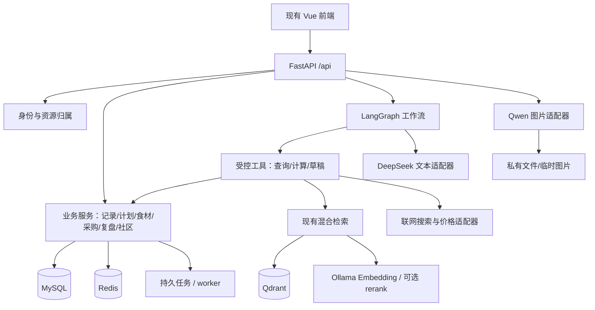

# OrangeDiary Python 重构与智能饮食助手设计文档

> 最新设计入口：`AI_CHAT_COOKING_IMPROVEMENT_PLAN.md`。本轮是统一聊天新增做菜意图/菜谱知识域，不另建厨师会话；下方历史设计链接发生冲突时以该新文档为准。

> 最新范围（2026-11-19）：用户已将本轮智能助手收敛为“按菜名教做菜、按食材推荐菜及做法、支持追问”，不继续本轮周计划/库存/采购/调整/复盘开发。本文保留架构与历史设计，具体新需求、开发顺序和验收以 `CHEF_ASSISTANT_DEVELOPMENT_PLAN.md` 为准；现状审查见 `CHEF_CODE_REVIEW_2026-11-19.md`。

版本：1.1 · 日期：2026-11-18（Asia/Shanghai） · 上一版：1.0  
用途：交给其他模型实施的需求、架构、契约与验收基线。本文描述目标系统，不代表功能已经实现。  
交付形式：一份 Markdown；不另行要求 Word。后续开发模型必须先读取全文及对应仓库最新代码。

## 版本记录

**v1.1（2026-11-18）**：把 `docs/DESIGN_REVIEW_GAPS.md` 的 36 条回填解答合并进正文。总体目标与范围不变，改动集中在这些位置：

| 位置 | 变化 |
|---|---|
| 1.4（新增） | R0–R4 阶段标签、人力假设、工程范围外 |
| 2.2 | 根 `main.py` 明确为转发壳，唯一入口是 `app/main.py` |
| 4.1 / 4.2 | 模型名拆成 requested 与运行配置；图片能力默认关闭 |
| 5 / 13.2 | 时区、日界、事件时间落到字段 |
| 6.2 / 6.3 | 私人厨师定义、食谱库规模、求解预算、多样性指标 |
| 7.2 / 8.1 / 9.1 | 提问上限、未知项与严格预算、观察记录跨日重算 |
| 11 | 复盘主副指标与展示门槛 |
| 12.2 / 12.3 | 删除 saver 选项，改由 `workflow_step` 恢复；确认命令移出工具表；调用预算 |
| 13.1 | Alembic 手写基线路线 |
| 14.1 / 14.2 / 14.3 | 分页命名、幂等头、归档与 capabilities 接口、旧 SSE 的 `card` 扩展 |
| 17.4（新增） | 分类限频 + token 硬预算 |
| 18 / 19.3 / 20 | 就绪判定与能力接口、回滚窗口、阶段与验收责任 |
| 21 / 23 / 24 / 附录D | 测试基础设施、阻塞分级、失败分支表现、旧文档标注清单 |

**标注约定**：本版新增的数值凡未经用户确认，标 `[design-default]`。它表示“实施时按此起步”，不表示用户已确认或已实测；要调整先改对应条款，再改实现。

## 0. 给开发模型的执行指令

1. **前端只在 `J:\develope\橘子rag\orange-diary-web` 中开发；完整 Python 后端只在 `J:\develope\橘子rag\orangeDiary-ai` 中开发。** 不另建平行前端、Python 后端或新的总项目目录。
2. `J:\develope\橘子rag\orangeDiary` 是待替代的 Java 项目，是业务、接口、数据库与测试的迁移参考。最终运行不依赖 Java，不再让 Python 回调 Java 执行业务工具。迁移验收前保留 Java 源码、配置模板和可恢复备份，不删除旧项目。
3. 本轮授权是设计文档。实施时以用户后续开发指令为准，不能把本文件视作现在即可删除数据库、清空 Redis、上线切流或销毁旧数据的授权。
4. 先检查各仓库 `AGENTS.md`、Git 状态和增量差异；保留已有未提交修改。本次观察到三仓均有未提交内容，不能 reset、clean 或覆盖式重建项目。
5. 按第 20 节逐阶段实施。每阶段交付可运行代码、迁移脚本、测试证据和更新后的接口说明；不能只实现聊天演示就声称完成后端替代。
6. 本文使用“已确认”“设计默认”“待核实”区分事实。设计默认允许实现模型在有证据时调整并记录理由；用户明确决定不可静默更改。
7. 现有前端继续使用 Vue，沿用海獭主题、现有导航和页面。新增能力用对话卡片与业务页面呈现，不能把模型名、向量库或工作流节点暴露给普通用户。
8. 本文确定的“完整Python后端替代Java”是新目标。现有 `AI_RAG_DEVELOPMENT_PLAN.md`、`EXECUTION_PLAN.md`、README及旧报告中“Java拥有业务、Python只做网关”的职责描述属于旧架构；保留其中仍适用的事实和测试，不能让旧职责分配覆盖本次用户决定。后续用户指令优先于本文。

## 1. 背景、目标和范围

### 1.1 项目背景

现有平台已经具备账号、食物查询、饮食/运动/体重记录、目标、社区、报告以及 AI 问答。仅提供记录和通用建议仍有四个问题：用户不会把营养原则变成具体三餐；聚餐、加班会中断计划；网上建议缺乏适用条件与出处；记录后缺少执行反馈。

目标是建立“了解个人情况 → 制定可执行饮食计划 → 辅助采购和做饭 → 记录实际饮食 → 局部调整 → 周期复盘”的闭环。私人厨师是交互入口，营养计算和约束校验是业务能力，知识库提供依据。

### 1.2 已确认的产品决定

| 项目 | 决定 |
|---|---|
| 后端 | 最终完全替代 Java，Python 同时负责业务与 AI |
| 代码目录 | 前端 orange-diary-web；后端 orangeDiary-ai，路径见第 0 节 |
| 服务人群 | 普通成年人，日常健康饮食与体重管理；以个人使用为主 |
| 文本模型 | 用户选择 Flash 系列（记为 `deepseek-v4-flash`）；运行配置用 `deepseek-flash`，见 4.1 |
| 图片模型 | 用户指定独立的 `qwen3.8-omni-flash`，需验证实际 API 标识 |
| 语音 | 不做语音输入、转写或语音输出 |
| 核心功能 | 多约束饮食规划、动态调整、有依据问答、私人厨师、食材核对、采购清单与联网参考价、外卖建议、周期复盘 |
| 库存语义 | 未记录不等于没有；正常推荐不以已录库存为封闭候选集合 |
| 采购路径 | 先推荐/选餐，核对相关食材，再计算确认缺口 |
| 现有数据 | 只有基础食物数据的用户陈述已确认；实际质量和覆盖需盘点 |

### 1.3 设计默认与边界

- 保留现有业务和有效数据，包括社区、管理端和原有 PDF 报告；这是为了完成后端替代。若以后删减，需明确记录范围变化，不得以“本次主要做 AI”为由漏迁。
- 计划、计划调整和从对话产生的记录均先预览，用户采纳/确认后生效。读取、计算、检索不额外弹确认。
- 首版包含食材图片识别与菜单/外卖截图分析；餐食照片识别与粗略营养记录列为后续增强。它们统一复用图片适配器。
- 首版不提供疾病治疗饮食、药物交互处方、未成年人/孕期专用计划或家庭多人独立目标求解。一般做饭人数仍可用于份量缩放。
- 单体模块化 Python 应用，Web 与后台 worker 同仓库、同镜像不同启动命令。不引入微服务或多个自主智能体。
- 本文不承诺减重速度、营养临床效果或价格实时准确度。

### 1.4 交付阶段、人力假设与工程范围外

阶段标签固定为 R0–R4，第 20 节阶段表已逐个标注对应关系：

| 标签 | 内容 | 对应阶段 |
|---|---|---|
| R0 | 基线：读三仓、存接口/表矩阵、跑离线测试与前端构建、核实模型能力 | M0 |
| R1 | 核心业务：DB/Alembic、认证、用户、食物、饮食/运动/体重/汇总/签到 | M1 |
| R2 | 旧功能全部兼容：社区、通知、上传、审核、PDF、AI 历史与 trace | M2 |
| R3 | 智能饮食闭环：厨师、规划、核对、采购、调整、复盘 | M3–M7 |
| R4 | 整体交付：恢复、压测、迁移演练、部署与全流程 QA | M8 |

- R1 可本地独立演示，属内部增量，不得对外称为“完整替代”，也不得提前关闭仍承载社区/报告业务的 Java；R2 之后新增功能不回调 Java。
- 人力假设 `[design-default]`：1 名熟悉 Python/Vue 的开发等效投入 + 模型辅助编码 + 用户负责产品验收，全量按 10–16 人周预留（旧业务迁移 3–5 周、智能能力 5–8 周、基线与综合验收 2–3 周）。区间只用于排期，不是工期承诺；M0 的任务分解替换此估算，不通过删功能压缩工期。

**工程范围外**（首版不做，接手模型不得自行扩展）：多地区与多机高可用、Kubernetes 与服务网格、微服务拆分、多租户组织权限、原生移动 App、i18n、开放的多时区设置、离线同步、可穿戴与智能冰箱接入、电商下单支付、持续学习自动训练、插件市场、多智能体自治。

首版部署为单主机：1 个 Web 实例（1 进程）、1 个 worker、1 个调度器。单机不等于可以省略事务与幂等——并发连接、重复投递、重启恢复仍须正确处理；多账号隔离与管理员权限必须保留，它不同于组织多租户。桌面与移动浏览器响应式在范围内。

## 2. 已检查的代码基线与迁移清单

### 2.1 检查范围

2026-11-18 读取源码、配置模板、SQL 结构、前端接口及路由；没有连接业务数据库、读取 `.env` 密钥、启动线上服务或执行付费模型调用。没有重跑历史测试，因此仓库报告里的通过数量不能当成本次验证结果。

基线提交短 SHA：Python `6179487`，Java `52b55d1`，前端 `bb41979`。三仓都有工作区变化，SHA 不包含这些变化。实施者必须重新获取状态。

### 2.2 现有实现事实

| 部分 | 当前观察 | 迁移方向 |
|---|---|---|
| 前端 | Vue 3、Vite 6、Pinia、Vue Router、Vant、Axios；原生 fetch 解析 SSE | 继续在原项目增量改造 |
| API 入口 | `src/api/http.js` 基址 `/api`，成功要求 `code === 0`；支持 token 刷新 | 保持现有响应外壳与认证返回字段 |
| 本地代理 | `vite.config.js` 的 `/api` 默认到 8080，变量名 `VITE_JAVA_API_TARGET` | 最终指向 Python；新增中性名 `VITE_API_TARGET`，过渡兼容旧变量 |
| Java 数据 | MySQL `calorie_tracker`，Redis 会话，MinIO 文件服务 | Python 首版保留 MySQL/Redis/MinIO，不同时迁移 PostgreSQL |
| Java 认证 | BCrypt；HS256 JWT，含 sub/jti/sid/typ；Redis 旋转 refresh token | 迁移语义，保留密码哈希；切流默认统一重新登录 |
| Python 入口 | 唯一真实入口是 `app/main.py`（应用、路由、lifespan）；根 `main.py` 仅是 `from app.main import app` 的转发壳，用于兼容 `uvicorn main:app` | 启动统一用 `python -m uvicorn app.main:app`；保留根壳，但不在根文件再建实例或注册路由 |
| 模型网关 | `app/services/model_gateway.py`、`app/clients/deepseek_client.py`、场景提示词 | 抽成统一文本模型适配器并复用 |
| 意图识别 | `app/services/intent_router.py`、`intent_validator.py`；内部 `/internal/ai/v2` | 复用结构校验，接入新工作流，不继续依赖 Java 工具 |
| RAG | `app/rag/`：Ollama bge-m3、Qdrant、jieba/BM25、RRF、可选 rerank、缓存、熔断、限流 | 保留并增强；不换成演示级 SQLite 全表向量扫描 |
| 知识资料 | `knowledge/sources` 检查到 13 个文件，另有索引、评测及本地模型目录 | 盘点授权与适用性后增量建设，文件数量不是知识质量指标 |
| Python 依赖 | 当前 requirements 尚未提供完整业务 ORM、迁移和 LangGraph 依赖 | 做兼容验证后增加并锁定版本，不随意降级现有依赖 |

Python README 对部分职责和 `.env` 加载的说明与当前源码已有差异：`app/config.py` 实际会加载项目根 `.env`，当前 Python 已有 RAG。以 owning source 为准，实施时同步更新 README。

### 2.3 必须迁移的旧功能

| 模块 | 前端/Java 参考 | Python 交付要求 |
|---|---|---|
| 注册/登录/刷新/退出 | `src/api/auth.js`、AuthController、AuthSessionService | 用户、角色、状态、密码验证、会话吊销与刷新旋转 |
| 个人档案与目标 | ProfileView/GoalView/BudgetView、UserController | 资料完整性、目标和预算，与新饮食偏好分开维护 |
| 食物与份量 | FoodItemController、food_alias/food_serving | 分类、分页、别名匹配、食物特定份量换算 |
| 饮食记录与汇总 | DietRecordController、DailySummaryController | 记录快照、日期归属、创建/删除后汇总一致性 |
| 运动与体重 | ExerciseRecordController、WeightRecordController | 原查询、预览、记录、曲线、进度语义 |
| 签到 | DailyCheckinController | 用户+日期唯一，重复调用不重复创建 |
| 报告 | DietReportController、前端 reports.js | PDF 字节、Content-Type、文件名及中文字体；同口径汇总 |
| 文件/头像 | ImageController、AvatarController | MinIO 存量对象访问、上传校验和归属 |
| 社区与通知 | Post/Notification/CommunityReport/Admin*Controller | 发帖、点赞、评论、举报、审核、通知、管理日志及权限 |
| AI 与追踪 | AiController、AdminAiTraceController | 历史、同步/流式、来源、知识状态、记录预览、配额和追踪 |

最终验收要在 Java 停止的情况下覆盖上述模块。迁移期间 Java 只作参考/差分测试，不形成长期业务依赖。

## 3. 总体架构与技术决定



| 层 | 决定 | 理由 |
|---|---|---|
| Web | FastAPI + Pydantic | 与当前项目一致；结构校验、OpenAPI、SSE |
| ORM/迁移 | SQLAlchemy 2 + Alembic；MySQL async 驱动优先验证 asyncmy | 复用 MySQL；业务迁移可追溯 |
| 计算 | Python Decimal、可选 Pandas 做离线整理 | 营养和金额由程序计算 |
| 规划 | 确定性候选筛选+规则校验；OR-Tools CP-SAT 做离散份量优化 | 真正校验多约束，不靠提示词保证 |
| 工作流 | LangGraph，具体版本集成验证后锁定 | 长流程状态、澄清、恢复与分支 |
| 检索 | 保留 Qdrant/BM25/RRF/可选 rerank | 复用现有能力和评测，不重复造基础设施 |
| 会话/队列 | Redis + MySQL 任务/幂等记录 | Redis 辅助缓存/会话；业务事实在 DB |
| 后台任务 | Celery + Redis；MySQL job 状态、outbox、业务幂等 | 进程重启后可恢复，避免仅用 FastAPI BackgroundTasks |
| 文件 | 复用 MinIO；图片分析文件使用独立私有前缀 | 与公开社区图片隔离 |
| PDF | 评估 ReportLab 实现兼容报告，中文字体随镜像 | 替代 Java PDF 实现，不依赖 Java |
| 测试/部署 | 保留现有 unittest，新增 pytest/httpx 集成测试；Docker Compose | 分层回归、跨语言接口兼容 |

Web I/O 使用异步客户端，CPU rerank/求解和同步检索在受控线程池或 worker 中执行，不能阻塞事件循环。数据库事务不能跨模型/联网等待；先读取版本快照，外部计算结束后短事务校验并保存。

## 4. 模型、图片与联网能力

### 4.1 文本模型

用户选择保留在 `TEXT_REQUESTED_MODEL=deepseek-v4-flash`，含义是“选择 Flash 系列”，不等于锁定旧模型权重。运行配置统一用推荐名 `TEXT_MODEL=deepseek-flash`：2026-11-18 官方文档说明推荐调用名为 `deepseek-flash`，旧名仍被接受，但请求由更新版本承接——该说明会变化，实施时必须重查，不能当作冻结版本的保证。

证据记录固定格式：`checkedAt=2026-11-18, source=https://api-docs.deepseek.com/, evidenceType=public_documentation, liveCallPerformed=false`。真实联调另记 requestedModel、configuredModel、responseModel（供应商未返回则 null）、providerHost、testedAt、traceId 与 usage，不存密钥；没有 live 调用不得回填 responseModel。第三方代理只接受旧别名时，用 provider 映射表配置实际 ID 并通过能力验证，不强行套官方别名。

来源：[DeepSeek 首次调用](https://api-docs.deepseek.com/)；[模型与价格](https://api-docs.deepseek.com/quick_start/pricing)。该页面会变化，不把当前单价永久写死，也不把旧名称当成旧版本仍可固定使用的保证。

必须验证文本、SSE、工具调用、JSON/结构化输出、超时、取消和 usage 行为。模型仅输出受校验结构；不支持原生 schema 时使用 JSON+Pydantic 校验、最多两次修复，失败返回显式状态。不要解析或存储隐藏推理内容。

### 4.2 独立图片模型

用户指定的 `qwen3.8-omni-flash` 记为 `VISION_REQUESTED_MODEL`，只表示意向、不传给供应商；运行配置 `VISION_MODEL=<verified-provider-model-id>` 在验证通过后回填，默认 `VISION_ENABLED=false`。供应商、精确 model ID、endpoint、鉴权和收费尚待验证。不得擅自替换为相似名称，也不得在未验证时声称一定可调用。

验证步骤（M0）：查供应商官方文档或控制台，确认精确标识、区域 endpoint、鉴权方式与支持的图片格式；在具备凭证且有调用授权时用一张测试图实跑，记录 requested/response 模型、时间、usage 与限制。通过才回填 `VISION_MODEL` 并启用；失败标 `blocked`，不自动换近似名称，也不在回填阶段执行付费调用。

实现 `VisionProvider`，与文本适配器分开配置、超时、限额、费用统计和功能开关。

首版场景：

1. 食材/包装/冰箱照片 → 识别可见食材、可见数量、包装标注 → 确认卡 → 更新食材记录或参与当次推荐。
2. 菜单/外卖截图 → 菜名、价格、规格、描述及可见促销条件 → 比较搭配 → 用户选择。
3. 后续餐食照片 → 仅菜品候选和估算范围；不能从单张图精确确认油盐、隐藏配料或克重。

图片结果只生成草稿：`items[{label, candidateFoodIds, visibleQuantity, quantityUnit, weightG:null, evidenceText, needsConfirmation}]`。不得以模型自报置信度作为准确率证明；被遮挡食材不补全为事实；包装到期日期需用户核对，不能凭外观保证安全。

用户上传图片而图片能力未配置时，返回 `VISION_UNAVAILABLE` 并支持文字补充，不把失败伪装成“没识别到食材”。不做任何语音接口。

### 4.3 联网适配器

实现 `WebSearchProvider.search(query, region, purpose)`，Tavily 等为候选，供应商和费用待定。purpose 区分 recipe/price/menu；健康知识默认走审核知识库，联网健康资料只能作为未审核补充，不能自动变成权威证据。

搜索适配器返回结构化来源、标题、链接、抓取/查询日期、摘录与可验证报价。外部内容是数据，不能指挥系统调用工具。网页抓取设超时、大小、重定向和 SSRF 防护；不允许请求环回、私网、云元数据地址或执行网页脚本。

## 5. 用户档案、目标与对话行为

复用现有 user/user_profile/user_goal，新增 diet_preference 保存过敏原、忌口、口味、做饭设备、可用时间、预算、手选城市、常备品和食材模式。健康档案不从一句闲聊永久推断；用户明确陈述或确认后更新。

- 必需信息缺失：只问影响当前任务的信息。例如营养目标缺乏基础资料时，不虚构身高体重；可先给非量化搭配，待用户补齐后定量。
- 信息来源优先级：本轮明确约束 > 用户确认档案 > 最近有效计划；旧聊天和总结不能覆盖新的过敏信息。
- “不吃海鲜”可能是喜好也可能是过敏：影响安全过滤时澄清；未知过敏原不标“安全”。
- 目标估算采用带版本的公式与有出处的活动系数，仅给估算；生理参数不足时允许用户自定目标或保留范围。默认策略、上下限、营养目标范围须在实施阶段形成可配置规则并附来源，不沿用示例项目固定赤字当普适规则。
- 首版唯一业务时区为 `Asia/Shanghai`，按自然日零点切分，不做夜宵自动归前一天。凌晨 01:00 的夜宵归该日；`meal_type=snack` 不改变日界。用户补记前一天时选实际发生日期/时间，不另设可任意覆盖的 `record_date`。
- 时区存放：`user_profile.timezone`，默认且首版只允许 `Asia/Shanghai`；新事件存 `occurred_at_utc`（`DATETIME(6)`，约定 UTC）与 `event_timezone` 快照，不在每张表重复用户时区。`known_ingredient` 的 opened/confirmed 是时间点，按 UTC 存；仅有包装日期时到期日保留本地 `DATE` 语义。
- 汇总口径：`daily_summary` 按 `(user_id, summary_date DATE)` 唯一键汇总，不做物理分区；`diet_day_status` 同一 DATE 规则；周报为当地周一 00:00 至下周一 00:00 的左闭右开区间。
- 旧数据里无 offset 的 `recordTime` 按 `Asia/Shanghai` 解释，新接口带 offset；`record_date` 由服务端按业务时区计算并校验，不接受客户端自拼。不能给所有旧 datetime 直接加 UTC 标签；未来更换时区需单独版本化迁移，不追溯重写旧日期。
- 前端本地日期不能用 UTC 截断造成跨日。
- 费用/执行时间/营养数据缺失时明确 unknown，不填 0。

## 6. 多约束饮食规划与私人厨师

### 6.1 统一输入

`PlanRequest`：日期范围（首版 1–7 天）、餐次、目标档案版本、做饭人数、预算及 strict/soft 模式、最大准备时间、口味/忌口、设备、已知食材、食材模式、允许外食、已锁定餐次。

三种食材模式：

| 模式 | 行为 |
|---|---|
| prefer_available（默认） | 优先利用已知食材，但可推荐含未记录食材的菜 |
| allow_purchase | 接受补购，在预算、营养、多样性之间优化 |
| available_only | 用户主动选择；仅用已确认可用食材，未知食材不得默认为有；不足时澄清/报告无解 |

### 6.2 核心流程

```text
理解需求 → 补齐必要条件 → 读取档案/实际饮食/计划版本
→ 筛选候选食谱和外食模板 → 计算营养/费用/时间
→ 优化组合及份量 → 独立校验 → 有限次数修正
→ 生成结构化草稿与解释 → 用户选餐/核对食材 → 用户采纳
```

**私人厨师是“菜谱选择与烹饪指导能力集合”的对外名称**，不是人格化智能体，也不是整个规划模块的别名：由同一助手调用食谱检索、份量缩放、做法与设备适配、替换建议。输入可以是需求文字、已确认食材或食材图片草稿；输出为食谱候选、步骤卡、替代与来源。营养目标与多天组合归规划服务，价格与购买归采购服务，普通问答不自动创建计划或采购事实。

它支持文字食材、已确认图片结果、做法步骤、设备替换、份量缩放、菜品替换及提问。做法来自食谱/烹饪资料；健康依据来自营养知识库。两者来源分类展示，不能用家常菜做法证明健康功效。前端复用现有聊天页与食谱详情卡，不另建聊天系统或独立的“厨师后台”。

### 6.3 求解与约束

**规模假设 `[design-default]`**：30 道经审查的食谱可做内部联调；M4 正式验收目标 100 道有效主菜/搭配模板（最低 60 道，且按约束评测有足够候选），每食谱最多 3 个经份量审查的档位。每餐先确定性筛到最多 20 个候选、合计 ≤60 个份量选项，7 天 ×3 餐最多 21 个餐位，约 1260 个选择变量量级——不是对全库任意连续克重求解。库大小本身不能证明贪心够用或必须上求解器：约束冲突、跨天多样性与包装预算在小库同样产生组合搜索，因此首版保留 CP-SAT。

以离散份量候选建模，例如每份/半份或带合理范围的克重档位；数量和营养做整数缩放以适配 CP-SAT。第一步可实现确定性贪心+回溯作为 baseline，但对外发布“多约束规划”前必须完成独立验证；优化器失败不得回落成未经校验的模型计划。

优化器封装为 `SolverProvider`，贪心/回溯只作基线与对照；CP-SAT 设 5 秒求解时间预算 `[design-default]` 并限制候选/变量规模，返回 `FEASIBLE_NOT_OPTIMAL` / `INFEASIBLE` / `TIMEOUT`。5 秒是设计超时、不是性能实测，M4 在标注机器上记录 P50/P95。候选不足时报“当前食谱库不足”，不自动生成未审食谱填满；最终可行性由独立校验器判定，不由算法品牌保证。

硬约束：明确过敏/禁忌；用户 strict 预算；可用设备；明确不可超过的做饭时间；available_only 的确认食材；合理份量边界；锁定餐次。营养目标通常是带容差的范围/软目标，若配置为硬限制需有依据和适用条件。

软目标：贴近营养目标、降低采购成本、利用现有/待优先使用食材、提高多样性、少重复、减少时间和浪费。权重可配置并记录版本；“临期优先”不能覆盖食品安全或过敏过滤。

多样性用可复算指标，不引入菜系熵 `[design-default]`：`unique_main_ratio = 不同主菜 family 数 / 主菜餐次数`（family 合并同菜不同份量），另计同一 `meal_type` 相邻自然日的主菜 family 重复次数 `adjacent_repeat_count`。7 天计划软目标 `unique_main_ratio ≥ 0.70`、`adjacent_repeat_count = 0`，只作目标，不凌驾过敏、预算或候选不足。用户指定“重复做这道菜”或允许批量备餐的餐次标 `exempt`，同时显示原始值与豁免值；主菜为零则指标 null。受限数据必须标 `diversity_degraded` 及原因，不因偏好重复判硬失败。

对预算使用价格上界校验 strict 场景；缺价时标 `budgetStatus=unverified`，不得显示“已满足预算”。允许用户在明确接受价格假设后继续，但保留未验证状态。soft 预算显示区间和超额原因。

冲突返回 `INFEASIBLE`、冲突条件和放宽建议；需区分“当前候选库找不到”与“所有现实方案均不存在”。超时返回 `TIMEOUT`；已有可行解可标 `FEASIBLE_NOT_OPTIMAL`，不能标最优。程序校验营养和食材后方可展示。

### 6.4 输出与计算规则

每餐提供菜谱、人数/份量、食材及生熟状态、步骤、制作时间、营养估算、费用区间、替代方案和推荐原因。保留 nutritionCoverage、priceCoverage、constraintChecks、assumptions、missingData。

基础计算：`营养 = Σ(食材对应状态的每100g营养 × 可食用克重 / 100)`。油、酱料、盐单独计入；区分生重/熟重、采购重/可食部、食谱总份量/用户实际吃的份量。缺生熟产率时不做精确折算；ml→g 必须有食物密度；个/碗/盒→g 必须有食物特定份量或包装信息。营养成分缺失保持 null 并报告覆盖率。

费用区分“本次采购支出”和“本餐消耗成本”：家中已有食材可能不产生新增支出，但并非营养/经济价值为零。多餐复用同一包装时，包装采购金额不能每餐重复累计。

## 7. 家中食材：不完整信息与按需核对

### 7.1 产品原则

前台称“家中食材”，不要求维护精确完整库存。允许“还有几个鸡蛋”“半袋牛肉”“大米一般都有”。未记录代表 unknown，而不是 absent。未知信息不进入“确定缺少”清单。

一条记录应拆开状态维度，不能用单个枚举同时表示数量和新鲜度：

- presence：present / absent / unknown。
- quantityState：known / approximate / unknown；quantity 和 unit 可空。
- freshness：fresh / stale / needs_review，由 lastConfirmedAt、食品类别及事件决定；确认有效期是可配置提醒策略，不能充当保质承诺。
- source：manual / photo_draft / purchase / cooking_confirmed；recognitionStatus 独立。
- foodState：raw/cooked/frozen 等、storageLocation、openedAt、expiryDate（均可空）。

“有，够用”只确认本次需求足够，不伪造出精确库存克重；常备品表示惯常持有，不是无限库存。用户可一键标“用完”“丢弃”“数量不确定”。

### 7.2 按需核对流程

1. 先按营养、时间、预算和偏好给 2–3 个有效候选；已知食材参与排序。
2. 用户选餐后生成该餐/多餐食材需求，扣除本轮可用且未被其他餐占用的确认量。
3. 只询问相关未知、过时或数量不明的食材，提供“有且够用／有但不够／没有／暂不确认”。
4. 未确认项进入“待核对”；确认缺少项才进入正式“待购买”。用户跳过时可显示条件采购量“若家中没有，需约…”，不算确定缺口。
5. 确认信息可供后续复用；按需确认优先于要求完整盘点。

**提问上限 `[design-default]`**：单屏最多展开 5 个具体食材问题，主动追问最多 2 轮，其余保留“待核对”。5 个是交互上限，不是需求项被截断——条目仍完整列在折叠清单里，用户可主动继续编辑。排序按可执行性与影响（主食/蛋白质、关键缺口，再配料），油盐等常备品可按组确认；批量“这些都有”必须是用户明确动作。两轮后给“先用当前信息继续”与“稍后核对”两个出口，未知仍是 unknown，采购量只能条件展示。`available_only` 下关键项未知不满足硬约束时，允许换候选或说明暂不能确认，不以超限为由断言缺少并建议全买。

### 7.3 预留、扣减与纠正

推荐/草稿不扣库存。采纳计划后对确定库存建立 reservation，避免同一200克被三餐各算一次；执行前再检查可用量与状态。用户确认实际做饭后，在事务中消耗相应预留并扣减；实际用量未知则标待核对，不强行扣精确克重。

取消/替换/过期释放预留；草稿切换不产生永久预留。用户调整库存时若低于预留量，标关联餐次需复核，不默默变负数。撤销、退货、丢弃、纠错写 ledger 补偿事件，保留因果和幂等键，不修改历史流水冒充从未发生。

照片识别、食材确认、饮食记录、实际烹饪是不同事件。吃了某道外卖不能自动扣家中食材。

## 8. 采购清单与价格

### 8.1 条目字段

| 类别 | 字段/行为 |
|---|---|
| 身份 | 标准食材、别名、规格、生熟/冷冻状态；关联原食谱和餐次 |
| 缺口 | 总需求、已确认可用量、预留、确认缺口、待核对量、计算假设 |
| 购买 | 建议购买量/包装数、包装克重、预计剩余及用途、替代选项 |
| 执行 | 待核对/待买/已买/缺货/跳过；按蔬菜/肉类/冷藏等分组 |
| 说明 | 挑选方式、购买时机、保存/解冻提示及可信来源 |
| 价格 | 单位标准化价格区间、地区、渠道、时间、促销/会员条件、来源链接 |
| 金额 | 预计支出区间、已知费用覆盖率、运费/门槛是否计入、实际支付价 |

缺口：`max(本次需求 - 分配给本次的已确认可用量, 0)`，仅在状态与单位可比较时成立。未知不能代0。多个计划合并先按日期/餐次去重，再按标准食材和可换算单位合并；不能只按名称合并生熟食材或不同规格。

**未知与严格预算**：只要有一个影响采购金额上界的数量、规格、可分配库存、费用或价格未知，strict 预算即 `budgetStatus=unverified`。unverified 既不是 `over_budget` 也不是 `infeasible`——信息不足不能判成不可行。只有采购缺口、包装规格与适用价格上界都确定时，才计算 `Σ(包装数 × 对应包装价格上界) + 已纳入的配送等费用` 并判 within/over；配送未计入时预算范围必须写成“食材商品金额，不含配送”，用户预算含配送而该值未知时仍 unverified。用户可显式选择“假设家中没有，全部购买”重建场景，结果标 `scenario_assumed`，不更新真实库存，也不与 `confirmed_budget_verified` 混用。

例：三天需600g，确认可分配200g → 缺400g；若常见包装500g，可建议买500g，预计余100g。若记录只是“有一点”，显示需600g、家中余量待核对，不计算400g之类的精确结果。

### 8.2 联网参考价格流水线

手选城市 → 标准食材/规格 → 查询近期零售报价 → 提取可验证信息 → 归一单位 → 区分普通/促销/会员/批发 → 输出范围和出处 → 缓存。

每条 `PriceObservation` 至少包含：foodId、region、channel、packageQuantity/unit、unitPriceLow/High、currency、priceType、observedAt、queriedAt、sourceUrl、evidenceText、validity、conditions。保留页面原价和归一值以便核验。

- 不能从搜索摘要虚构价格。来源无时间则标时间不明；过期、跨城、批发/促销价格不可无提示混为普通零售价。
- 有一个来源时标单来源；多个可比来源可汇总区间，不能把区间包装成统计置信区间。
- 无可验证报价时显示“暂无可靠参考价”；历史价格/用户实购价可作单独类别，不能伪装成今天价格。
- 默认缓存建议24小时，生鲜/促销可更短，均可配置。跨地区、规格、价格类别不能共用缓存。
- 总费用有未知项时给已知小计与未知项数量，不能给完整确定总价。严格预算未覆盖时无法认证通过。
- 替代食材必须重新校验过敏、营养、费用、份量和做法，再由用户采纳。

### 8.3 购买与库存联动

“勾选完成”与“确认买到并入库”界面合并成简短确认：实际规格/数量、可选实付价、是否入库。重复点击不重复入库。清单关联 inventoryLedgerId 可追溯；错误勾选可撤销/补偿。计划替换后只更新未购买条目，已购买事实保留，余料进入后续推荐。

## 9. 实际记录、计划动态调整与外食

### 9.1 饮食记录

保留原有食物选择与克重记录，同时支持自然语言预览：“中午吃了一碗米饭和两个鸡蛋”。匹配多候选或份量不明时先确认。不同食物的“碗、个”不能共用固定克重；用户选择估算后保留 estimated 标记及范围。

原 `diet_record` 要求 food_item_id 和 quantity_g。对没有可用 food ID/克重的复杂外食，新增 `meal_observation` 保存事件及可信程度，不能创建虚构的精确 food_item 或 quantity_g 来硬塞旧接口。后续确认匹配后关联正式记录；汇总查询必须防止 observation 与已关联记录重复计入。营养估计也应有独立版本和方法标记。

确认保存前预览；保存事务负责记录快照、汇总更新、幂等和 outbox，之后才触发计划复核任务。对修改/删除也重算影响日期。数据库营养字段更新不重写历史记录快照。

**迟到确认的重算范围**：observation 状态为 `draft → confirmed_unmatched → resolved / retracted`。draft 不计入；confirmed_unmatched 只有在已确认估算存在时进入 estimated 小计，没有数值只降低完整度；resolved 由正式 `diet_record` 计入，不再叠加原估算。

把一条 observation 拆成多条正式记录时，必须一次性建立完整 link 集合并同时改 resolved，不允许“部分正式记录 + 完整原估算”同时有效；无法完整拆解时先留 unmatched。重算日期集合 = 变更前后 observation 的 `record_date` ∪ 所有新增/修改/删除/解除关联 `diet_record` 的旧、新 `record_date`；确认发生在三天后也重算进食当天，跨日修改则两天都算。

在同一用户健康写入行锁下用短事务完成状态、link 与记录修改，按唯一日期集合排序重建 `daily_summary`。保留旧精确小计，新增 estimated 小计与 coverage 字段；合计值若含估算必须标注口径。解除 link 走命令：恢复原 observation 时同时撤销该解析产生且仍有效的正式记录；保留正式记录时 observation 保持不计入或标 retracted，不能恢复双计。提交后由 outbox 将相交期间的周报标 `stale`、相关未执行计划标 `needs_review`，不自动覆盖已采纳方案。

### 9.2 动态调整

触发事件：聚餐、外卖、加班、运动取消、食材缺货、计划餐未执行、用户明确修改目标。录入变化后先提供“是否调整后续餐次”的卡片，或按用户已设偏好自动生成草稿；没有采纳不覆盖生效计划。

流程：读取当前计划版本及输入数据版本 → 区分记录完整/不完整 → 识别需改的未执行餐次 → 锁定已吃/用户锁定项 → 查询替代候选 → 重新计算校验 → 输出差异草稿 → 用户采纳产生新版本。

限制：不因一次聚餐建议跳餐、过度运动或连续极端压低能量；不凭“吃了火锅”给精确超额。剩余目标出现负值时说明已记录摄入情况，不能把负值直接当下一餐份量。无法定量时提供定性搭配与补充信息入口。

变更卡同时显示旧/新菜品、份量、费用、时间、原因、假设、受影响采购项。采纳后对未购采购项及库存预留做可追溯重算；已购、已食用事实不可被新计划覆盖。

### 9.3 外卖与菜单

用户输入商家/菜品或上传截图，系统只分析可见选项，不承诺实际配料与克重。比较依据包括主食、蛋白质来源、蔬菜、可选做法和预算；提供“少酱/酱汁分开”等可执行备注，但不假装商家必然支持。

菜单价格区别单点价、套餐价、起送价和优惠条件；不把截图价格当全城市场价。推荐外卖后可生成饮食记录草稿与剩余餐次调整，不扣家中食材。不自动下单、支付或向商家发送信息。

## 10. 营养知识库与有依据问答

### 10.1 三类数据分工

1. 权威营养知识：膳食指南、官方机构资料、适用人群、版本/日期、原文位置。负责解释与依据。
2. 烹饪与食谱：用量、做法、时间、设备、份数、替代、来源与授权。负责私人厨师执行内容。
3. 结构化业务数据：食物营养、份量映射、用户档案和实际记录。负责计算和个性化事实。

用户记录不混入全局知识索引。全局知识、用户私有食谱、管理员资料必须具备作用域过滤；检索后再验证来源归属。

### 10.2 复用检索链路

保留现有缓存 → 向量+BM25 → RRF → 可选 rerank → 证据过滤。新增来源分类、适用人群、发布时间、状态和授权元数据；按标题/语义切分，保留警告条件与上下文。索引更新采用版本发布与回滚，不在线原地破坏正在使用的版本。

Embedding 模型/维度变更要重建索引，不能把不同空间的向量混用。价格查询证据与营养问答证据分开，不把菜价页面用于健康结论。

现有阈值是在原资料/评测集上配置的，新菜谱和新领域必须重新做开发集/独立留出集评测；不能照搬0.60、0.75等数值声称准确。新增词汇时同步评估 BM25、向量、融合、重排及拒答消融。

### 10.3 引用契约

工具返回 evidenceId/chunkId/documentId、title、publisher、publishedAt、section/page、sourceUrl（可空）、quote、scope、version。模型只能引用本轮提供的 evidenceId；服务端校验引用存在、链接来自记录，前端用来源抽屉展示。不存在的引用拒绝渲染并触发修复；无核实链接的来源显示为文本。

出处存在不代表支持结论。评测要检查“结论是否被对应原文支持”和适用条件是否保留。回答区分：来自用户记录的事实、程序计算、参考资料、建议和不确定性。

保留 `knowledgeStatus=ok|no_evidence|busy|unavailable|skipped`：没有证据与检索服务故障不可混为一谈。没有证据时不编引用；基础解释可明确说明未获得匹配依据，具体健康结论不得伪装为已核实。

## 11. 周期复盘与持续优化

默认按用户时区周一至周日，可随时手动生成，周期由日期范围表示。后台生成可开关，避免部署多个 Web worker 重复调度。

程序先计算事实，模型再解释：记录天数/明确标记完整天数、已采纳计划餐次、明确执行/未执行/未知餐次、食材替换、费用覆盖与实付、满意度/饥饿感、体重趋势、营养缺失率。

- `confirmedExecutionRate = executed / (executed + explicitlySkipped)`；分母为0则 null。另展示 `executionCoverage = (executed + explicitlySkipped) / dueAdoptedMeals`，不能把没反馈直接算未执行。
- 对外口径：主指标是 `confirmedExecutionRate`，文案“已反馈的 5 餐中，完成 4 餐（80%）”；副指标是 `executionCoverage`，文案“本周计划 9 餐，已反馈 5 餐，另 4 餐待确认（覆盖 56%）”。仅在 `dueAdoptedMeals > 0`、反馈 ≥3 餐且 coverage ≥60% 时主卡显示百分比 `[design-default]`（这是展示策略，不是健康科学阈值）；否则显示“反馈不足，暂不评价执行情况”，保留完成/跳过/待确认计数。没有采纳计划显示“本周没有可统计的饮食计划”。不得用“本周整体执行率 80%”掩盖未知餐次。
- 营养日均值标明分母是“已记录天”还是“完整记录天”；未记录不当0。至少支持用户标记当日记录是否完整。
- 体重趋势显示观察区间和样本数；少量短期数据不足时不推断脂肪变化、因果或承诺减重效果。
- 复盘可提出“加班日可能影响执行，是否需要快速餐”等假设，不能擅自断言原因。

周报包含事实、数据缺口、可能障碍、最多3项改进建议和下周变更草稿。用户采纳后才修改计划/偏好。报告存 inputSnapshotHash、规则/提示词版本、模型信息、生成时间；记录修正后标旧报告过期，可重算，不悄悄改历史报告。

## 12. 状态、工作流与工具边界

### 12.1 状态机

| 对象 | 状态与转移 |
|---|---|
| 任务 | queued → running → waiting_input / succeeded / partial / failed / cancelled；waiting_input 可带版本恢复 |
| 计划草稿 | draft → validating → needs_input / feasible / infeasible / failed；feasible 才可采纳 |
| 生效计划 | adopted → superseded / completed / cancelled；修改产生新版本，保留旧版本 |
| 餐次 | planned / executed / skipped / unknown；执行与食材消耗独立确认 |
| 核对会话 | open → partially_confirmed → confirmed / expired；需求变化生成新会话版本 |
| 采购条目 | needs_check → to_buy → purchased；另有 unavailable/skipped；撤销产生补偿事件 |
| 图片任务 | uploaded → analyzing → draft_ready → confirmed / rejected / failed / expired |

对象状态用业务 DB 持久化，不能只放在聊天文本、进程内字典或 LangGraph checkpoint。conversationId、jobId、draftId、planVersion 是不同标识。

### 12.2 LangGraph 设计

统一路由节点分类 query / chef / plan / adjust / inventory / shopping / review / menu / record。简单食物查询直接走确定性工具，不每次启动完整求解。规划节点包括 collect_requirements、load_context、retrieve_candidates、compute、solve、validate、prepare_draft。用户输入暂停保存在 DB；恢复时检查输入/计划版本，不拿旧草稿覆盖新状态。

**定位：LangGraph 只负责单次执行内的状态图编排，不承担跨进程 checkpoint 恢复。** 保留它是为显式表达路由、澄清出口、有限修复与求解分支；不把引入 LangGraph 包装成已实现 durable execution。首版不配置任何 LangGraph saver，也不承诺 token 级续传或“模型恰好调用一次”。

跨重启恢复由 MySQL 的 `job`、`workflow_step`、`input_snapshot` 实现：完成节点在短事务中保存输出与事件；worker 重新领取租约后，复用“已完成且输入版本匹配”的结果，从未完成节点重新调用图；输入变化则创建新 attempt。`waiting_input` 结束本次图执行，用户答案提交后先校验版本，再启动下一次执行。

崩溃可能造成只读模型调用重复，计入实际费用；所有写操作仍由确定性 API 与 DB 幂等控制。验收必须覆盖三类：worker 在节点前后崩溃、等待澄清时重启、旧输入恢复被拒绝——不允许用 MemorySaver 通过冒充恢复通过。

### 12.3 工具清单

| 工具组 | 示例 | 权限 |
|---|---|---|
| 用户与记录 | get_profile/get_goals/get_diet_records/get_record_completeness | 当前用户，只读 |
| 知识/食物 | search_nutrition_docs/search_cooking_docs/search_foods/get_servings | 按资料作用域，只读 |
| 计算/规划 | calculate_nutrition/estimate_cost/validate_plan/solve_plan | 无外部写入 |
| 食材/采购 | get_known_ingredients/build_checklist/search_prices/build_shopping_draft | 查询与草稿 |
| 记录与调整 | build_record_preview/build_adjustment_draft/build_review | 草稿 |
工具注册表固定白名单和 Pydantic 参数；userId 从认证上下文注入，模型参数中不允许指定他人身份。禁止任意 SQL、任意 shell、任意 URL 抓取。

`adopt_plan`、`confirm_record`、`confirm_inventory`、`confirm_purchase` 等用户确认命令**不进入模型工具注册表**：schema 与运行时 allowlist 都不含 adopt/confirm/purchase，模型只能产出草稿与确认卡。前端确认 → 认证命令 API → 归属/版本/幂等校验 → service 事务。自然语言“就按这个买吧”首版只返回确认卡，不直接写入。验收要检查发给供应商的 tools 列表、注册表单测与恶意 `tool_name` 请求，均不能发现或执行这些命令；直接访问 API 仍须正常鉴权。

**调用预算 `[design-default]`**：每任务最多 3 次文本调用（含修复），每轮工具数上限 8，结构修复最多 2 轮；原文“最多两次修复”服从总调用上限。达到上限以 `TOOL_BUDGET_EXCEEDED` / `MODEL_CALL_BUDGET_EXCEEDED` 结束并解释，不无休止循环。限制可配置，并按实际任务评估调整。

## 13. 数据模型与一致性

### 13.1 现有表处理

保留 user、user_profile、user_goal、food_item、food_alias、food_serving、diet_record、exercise_item、exercise_record、daily_summary、weight_record、user_daily_checkin、ai_conversation、ai_conversation_message、ai_chat_trace 及社区/通知/文件相关表。实际结构以迁移前 `information_schema` 与 Java entity/SQL 对照为准，不能只执行旧建表 SQL。

`calorie_tracker.sql` 含 DROP TABLE，是旧初始化快照，**不可作为现有数据库升级脚本直接执行**。

Alembic 路线固定为“手写基线 + 指定 revision stamp”，禁止对存量库直接 autogenerate 或 `stamp head`：

1. 从授权数据库副本只读导出 `information_schema` 与 `SHOW CREATE TABLE`，与 Java SQL/entity 对照，去除敏感数据。
2. 手写 `0001_legacy_baseline`：只创建旧架构表、索引、约束，不含 DROP，不含新功能表；新表与扩展从 0002 起。
3. 在空 MySQL 执行 `alembic upgrade 0001_legacy_baseline`。
4. 把空库结构与副本结构做规范化 diff：字段类型/长度、nullable/default、字符集与排序规则、索引列顺序与唯一性、外键及 ON DELETE/UPDATE；忽略自增当前值与统计信息，其余差异必须逐条解释。
5. 只有 diff 通过的存量副本才执行 `alembic stamp 0001_legacy_baseline`（stamp 不建表）。
6. 空库与存量副本分别 `upgrade head` 并验证；存在多个历史变体时先做 legacy bridge 迁移与备份，不强行 stamp 假装一致。

`stamp head` 在已有新 revision 时会跳过真实 DDL，故不采纳。新功能迁移允许 autogenerate 草稿，但必须逐句 review，不能当作生产库的自动修复器。

### 13.2 新增/扩展表的最低字段

通用：主键、created_at、updated_at；用户私有表必须 user_id 并建立以 user_id 开头的查询索引；可并发修改对象有 version。ID API 统一规则见第14节。下表为规范化逻辑设计，DDL 在实施阶段依据实际 MySQL 版本生成。`user_profile` 增加 `timezone`（首版仅 `Asia/Shanghai`）；健康事件表增加 `occurred_at_utc` 与 `event_timezone`，规则见第 5 节。

| 表 | 关键字段与约束 |
|---|---|
| diet_preference | user_id唯一、allergens、dislikes、cuisine_preferences、equipment、prep_time_limit、budget_mode/value、city、ingredient_mode、version |
| food_nutrition_meta | food_item_id、basis(raw/cooked)、edible_ratio、nutrient_source、source_version、verified_at；未提供营养项可空 |
| recipe | name、owner/scope、source_url、license、servings、prep/cook_minutes、equipment、status、version |
| recipe_ingredient | recipe_id、food_item_id可空、original_name、quantity/unit、gram_equivalent可空、basis、optional、allergen_status |
| recipe_step | recipe_id、step_index、description、duration_hint、equipment |
| recipe_nutrition | recipe_id+recipe_version、nutrients、coverage、calculation_version、input_hash |
| known_ingredient | user_id、food_item_id可空、label、presence、quantity_state、quantity/unit、food_state、storage_location、last_confirmed_at、expiry/opened_at、source、version；允许分批次 |
| ingredient_ledger | user_id、ingredient_id、event_type、delta可空、before/after、unit、cause_type/id、idempotency_key唯一、created_at |
| ingredient_reservation | user_id、ingredient_id、plan_meal_id、quantity/unit、status、expires_at；同一来源预留唯一 |
| ingredient_check_session/item | user_id、plan/draft_version、needed_quantity、existing_assessment、answer、confirmed_quantity可空、status、version |
| meal_plan | user_id、start/end_date、active_version_id、status、version |
| meal_plan_version | plan_id、version_number唯一、parent_version_id、input_snapshot、constraints、checks、nutrition/price_coverage、reason、status、adopted_at |
| plan_meal | plan_version_id、date、meal_type、recipe_id/version可空、servings、nutrition_snapshot、cost_range、execution_state、locked |
| meal_observation | user_id、occurred_at、description、source、estimated_nutrition可空、completeness、confidence_kind、status |
| observation_record_link | observation_id、diet_record_id唯一；阻止汇总重复计数 |
| diet_day_status | user_id+date唯一、completeness(unknown/partial/complete)、confirmed_at |
| shopping_list | user_id、date_range、plan_version_refs、status、totals/coverage、version |
| shopping_item | list_id、food/spec、need/available/shortage、quantity_status、buy_quantity/package、state、price_snapshot、ledger_id可空 |
| shopping_item_source | item_id、plan_meal_id/recipe_ingredient_id、required_quantity/unit；用于需求重算去重 |
| price_observation | food/spec、region/channel、quote/normalized_unit、low/high、currency、price_type、observed/queried_at、url、evidence、conditions |
| review_report | user_id、period、input_hash、metrics、data_gaps、suggestions、draft_plan_ref、status、model/prompt/rule_version |
| user_feedback | user_id、plan_meal/recipe_ref、rating、hunger/satiety可空、difficulty、reason、created_at |
| media_asset / image_analysis | owner、private_object_key、purpose、mime/size、expires_at；analysis含provider/model、input_hash、result_draft、state |
| job | user_id、kind、status、input_hash、progress、result_ref、error_code、attempts、lease_until、version |
| workflow_step | job_id、node_name、attempt、input_hash、state、output_ref、started_at、completed_at、lease_token；`(job_id,node_name,attempt)` 唯一，完成节点在短事务中写输出与事件 |
| outbox_event | event_id、type、aggregate_ref、payload、published_at、attempts；与业务写入同事务 |
| command_idempotency | user_id+operation+request_key唯一、payload_hash、state、response_ref、expires_at |

已有 idempotency_record 能表达相同语义时扩展复用，不重复建同义表。结构化规则允许 JSON 保存版本快照，但不能把所有业务存成一个 JSON 大字段而放弃查询、约束和归属校验。

### 13.3 数值与事务

- 金额使用 Decimal，保存币种；营养数值用 Decimal，最终展示才按规则四舍五入，避免逐项取整造成合计漂移。
- null=未知，0=确认零。小计、覆盖率和 unknownCount 分开；不能 COALESCE 成0后宣称完整。
- 乐观锁 `UPDATE ... WHERE id AND user_id AND version`；冲突返回409与当前版本。采纳新版本与替换旧生效指针同事务，每用户/日期餐次不出现两个冲突生效版本。
- 幂等同键同请求回原结果；同键不同 payload 返回409。模型重试、HTTP重试、队列重复投递都不能重复记饮食、购买或扣库存。
- 数据库唯一约束与行锁负责最终正确性，Redis 锁只是降低竞争。记录与 daily_summary 同事务重算，复用旧 HealthSummaryWriter 的并发保护语义。
- 迁移阶段先用旧Java相同的计算/舍入样例验证兼容；若新计算口径改进了中间舍入或单位换算，用独立calculationVersion和新快照记录，不能静默改变旧记录数值。
- 后台任务采用至少一次投递和幂等消费者；outbox 失败重试，不能把“提交数据成功但队列发送失败”变成丢任务。

## 14. HTTP、SSE 与异步任务契约

### 14.1 兼容规则

公开业务路径继续 `/api/...`。成功外壳保持：

```json
{"code":0,"message":"success","data":{},"traceId":"server-generated-id"}
```

失败用适当 HTTP 400/401/403/404/409/422/429/503，同时返回非0 code、安全 message、data可空、traceId；新增稳定 `errorKey`，不向用户返回 SQL/堆栈。旧 code 语义按前端和 Java 实际对照保持。

Python 内部 snake_case，公开 DTO 用 camelCase。分页分两套且不互相污染：旧接口入参 `page/size`、出参 `records/total/current/size` 保持不变；新接口入参 `page/pageSize`、出参 `{records,total,page,pageSize}`，`page` 从 1 开始、`pageSize` 默认 20、最大 100。前端新增 `normalizePageResponse`，在 API 适配层把旧结构转成标准结构给页面，新页面只认标准结构；不给同一字段同时保留 `current` 与 `page` 两个同义出口。日期范围含首尾，API 显式记录时区；旧无时区时间按 Asia/Shanghai 解释，新接口 ISO8601 带时区。

**幂等传输**：新写命令统一用 `X-Request-Id` 头传前端生成的 UUID；正文里过渡保留的 `requestKey` / `clientRequestId` 必须与头一致，不一致返回 400。服务端不按 body hash 创建身份键，body hash 只用于识别“同键异请求”。后台派生命令用 `jobId + step + 业务对象` 构造稳定键。409 按 `errorKey` 区分：`IDEMPOTENCY_PAYLOAD_MISMATCH`（这次提交与原请求不一致，请检查后重新提交）、`VERSION_CONFLICT`（方案已更新，请刷新核对后再操作）、`REQUEST_IN_PROGRESS`（请求正在处理中，请稍后查看，保留原键）。幂等结果默认保留 7 天，客户端最长重放 6 天；过期 pending 先查业务事实，不静默重提。

旧整数ID在兼容接口维持原类型，新主键使用短字符串/UUID；若发现大于JS安全整数的存量ID，必须前后端统一升级成字符串，不能只改后端。新公开金额/营养数值为 number或null，内部Decimal不泄露默认字符串编码；超范围明确校验。

### 14.2 新接口最小集合

以下为设计接口；请求/返回须落到 Pydantic schema 和 OpenAPI。所有资源路径均做归属校验。

| 方法/路径（均在/api下） | 输入重点 | 输出/行为 |
|---|---|---|
| GET/PUT /diet-preferences | version、过敏/偏好/城市/预算 | 当前档案与新版本 |
| POST /assistant/requests | message、conversationId可选、attachmentIds、clientRequestId | requestId/jobId及accepted状态 |
| GET /assistant/requests/{id}/events | 身份、事件游标可选；前端fetch | 扩展SSE，断线后重取状态而非重复生成 |
| GET /jobs/{id} | 无 | status、stage、resultRef、errorKey |
| POST /jobs/{id}/cancel | version | 请求取消，保留已完成业务事实 |
| GET /conversations；POST /conversations | 分页 / title可选 | 会话列表 / 新会话 |
| GET /conversations/{id}/messages | 游标 | 用户可见消息、卡片引用与状态 |
| POST /meal-plans/drafts | PlanRequest | 202 + jobId |
| GET /meal-plans/drafts/{id} | 无 | 草稿、缺失信息、检查结果 |
| POST /meal-plans/drafts/{id}/answers | draftVersion、澄清答案 | 继续执行/新任务 |
| POST /meal-plans/drafts/{id}/adopt | draftVersion、inputVersions、requestKey | 生效计划及版本；409表示过期 |
| GET /meal-plans | startDate/endDate | 当前生效餐单 |
| GET /meal-plans/{id}/versions | 无 | 历史差异 |
| POST /meal-plans/{id}/adjustments | expectedVersion、event/constraints | 调整草稿，不直接改生效计划 |
| POST /plan-meals/{id}/execution | state、actualUsage可选、requestKey | 执行与可确认的食材消耗结果 |
| GET/POST /known-ingredients | 查询 / 用户确认数据 | 食材列表 / 新记录 |
| PATCH /known-ingredients/{id} | expectedVersion、变更 | 新记录版本和影响提示 |
| POST /ingredient-checks | draft/planVersionRef | 待核对条目 |
| POST /ingredient-checks/{id}/answers | expectedVersion、逐项答案 | 确认缺口及仍未知项 |
| POST /shopping-lists | confirmedCheckRefs、planRefs | 合并清单，分开待核对/待买 |
| GET /shopping-lists/{id} | 无 | 条目、费用区间和数据覆盖 |
| POST /shopping-lists/{id}/price-refresh | city、规格、requestKey | 202价格任务 |
| PATCH /shopping-items/{id} | expectedVersion、数量/规格 | 重算结果 |
| POST /shopping-items/{id}/purchase | actualQuantity/unit、paidPrice可选、addToIngredients、requestKey | 购买事实及入库结果 |
| POST /shopping-items/{id}/purchase-reversal | expectedVersion、reason、requestKey | 补偿事件，不删除已用掉的事实 |
| POST /known-ingredients/{id}/archive | expectedVersion、reason、requestKey | 归档；有活跃预留返回 409 并列出受影响餐次 |
| DELETE /assistant-media/{id} | 无 | 删除本人图片原件，撤销访问并后台清理对象与缓存 |
| GET /capabilities | 无 | 各能力状态，结构见 18 节 |
| POST /meal-observations | description、time、completeness | 非精确饮食事件草稿/确认 |
| PUT /diet-days/{date}/completeness | partial/complete/unknown | 更新复盘数据质量 |
| POST /reviews | startDate/endDate、requestKey | 202周报任务 |
| GET /reviews/{id} | 无 | 统计、缺口、建议、草稿链接 |
| POST /feedback | 对象与反馈 | 保存个人反馈 |
| POST /assistant-media | multipart file、purpose | 私有assetId和expiresAt |
| POST /image-analyses | assetId、purpose(ingredient/menu) | 202图片任务 |
| POST /image-analyses/{id}/confirm | version、editedItems | 用户确认结果；可选关联食材命令 |
| POST /menu-analyses | text或confirmedImageResult、preferences | 外卖候选比较草稿 |
| GET /recipes；GET /recipes/{id} | 筛选 / ID | 食谱、步骤、来源、营养覆盖 |
| POST /admin/knowledge/imports | 管理员文件/来源元数据 | 导入任务；不向普通用户开放 |

### 14.3 旧聊天接口兼容

保留 `/api/ai/chat`、`/api/ai/chat/stream`、`/api/ai/conversation/messages`。旧请求 `{message}` 由服务端选择用户当前会话；不要求浏览器发送可信历史。同步返回保留 reply、conversationId、action、recordPreview、exercisePreview、sources、knowledgeStatus，可加 cards 字段。旧 history 的 role/content/createdAt 保持，新增卡片引用让刷新后可恢复。

旧SSE必须保留：

```text
event: knowledge
data: {"status":"ok"}

event: sources
data: [{"evidenceId":"e1","title":"资料标题","sourceUrl":null}]

event: message
data: 用户可见文本片段

event: done
data: conversation-id
```

message 为原始文本，done 为会话 ID，不能静默改成 JSON。新增 `card` / `progress` 事件时必须前端先支持再启用；新 request 事件接口可以全部用 JSON，但与旧协议分开。`error` 事件提供安全提示，traceId 走响应头或扩展事件。

旧聊天识别到复杂任务时不在此通道里等待恢复：由同一 assistant service 创建任务，发一条 `card` 事件（`requestId` / `jobId` / `resourceRef`），再按原格式发 `done` 结束。旧客户端不认识 `card` 时只显示任务摘要与跳转提示，不能把复杂任务误报成已完成。`done` 只表示该次旧响应结束，不表示子任务成功。

新事件协议（`GET /assistant/requests/{id}/events`）使用单调 `eventId` 与 JSON envelope，至少包含 `progress`、`text_delta`、`card`、`waiting_input`、`completed`、`failed`。`waiting_input` 带 `draftId`、`draftVersion`、`questions` 与服务端白名单生成的 `resumeUrl`，并关闭本次流；用户答案走草稿 answers 命令，不往 SSE 连接写入。重连从持久游标补读或查资源快照；事件默认保留 7 天，到期返回快照并说明不可回放。

SSE需要UTF-8、禁止代理缓冲、心跳、取消传播、连接清理；解析器支持CRLF、多data行、UTF-8跨chunk和EOF。旧前端当前按 `\n\n` 切帧，升级时补齐CRLF边界测试。已经输出内容后不能盲目回落同步生成；用户可重连查询同request状态，不能重复创建计划。

### 14.4 核对与采购响应示例

```json
{
  "code":0,"message":"success","traceId":"t1",
  "data":{
    "checkId":"chk_1","version":2,
    "items":[
      {"foodId":12,"name":"鸡胸肉","neededG":600,"presence":"present",
       "quantityState":"known","availableAllocatedG":200,"shortageG":400,
       "status":"confirmed","suggestedBuyG":500,"expectedLeftoverG":100},
      {"foodId":19,"name":"西兰花","neededG":300,"presence":"unknown",
       "quantityState":"unknown","availableAllocatedG":null,"shortageG":null,
       "status":"needs_check","conditionalBuyG":300}
    ]
  }
}
```

第一条的200g必须已为本次需求分配且没有重复预留；第二条不能被UI展示成“确认缺300g”。这也是测试固定样例。

## 15. 前端改造位置与交互要求

### 15.1 保留与增量修改

| 文件/目录（相对前端根） | 改造要求 |
|---|---|
| `src/api/http.js` | 保留code=0、token刷新、traceId错误提示；按新接口补幂等与409处理，不全局任意延长所有请求超时 |
| `src/api/ai.js` | 继续兼容旧聊天；增加request/job/card协议与流取消/恢复 |
| `src/views/AiChatView.vue` | 对话入口、步骤提示、卡片、附件；服务端历史恢复，不把临时localStorage当业务主库 |
| `src/router/index.js` | 新增计划、家中食材、采购、复盘路由；沿用登录/资料/管理员守卫 |
| `src/views/DietOverviewView.vue` | 下一餐卡、计划与实际摄入、调整入口 |
| `src/views/ProfileView.vue` | 忌口/过敏、设备、时间、城市等配置；与已有身体资料协调 |
| `src/views/BudgetView.vue` | 保留原热量预算概念；新增“买菜金额预算”用独立命名，避免混淆 |
| `src/views/AdminAiTraceView.vue` | 增加实际模型、工具耗时、引用/降级、任务状态及费用覆盖 |
| `src/config/features.js` | 新功能开关，未配置图片/搜索能力显示合适入口状态 |
| `vite.config.js` | 代理改成Python目标，中性变量VITE_API_TARGET兼容旧变量 |

建议新增而非强制固定文件名：`src/api/{mealPlans,ingredients,shopping,reviews,assistantMedia}.js`、`src/components/assistant/`、`src/views/{MealPlan,Ingredients,ShoppingList,Review}View.vue`。开发时按既有组织调整，但不得把前端代码放进Python目录。

### 15.2 卡片协议与页面职责

统一 `AssistantCard={id,type,schemaVersion,resourceId,resourceVersion,status,summary,actions}`。type包括 meal_plan、ingredient_check、shopping_list、adjustment、record_preview、menu_comparison、review、image_confirmation。卡片只引用服务端资源和允许的动作，不传任意HTML或由模型指定执行URL。

按钮调用确定性命令API，禁用重复提交并保留幂等键。资源已变更时显示“方案已更新，请刷新核对”，不能继续操作旧卡片。刷新后从服务端恢复内容与采纳状态。

主页面以精简可执行信息为主：餐单显示份量/时间/费用区间；采购显示待核对与待买两个分组，挑选、出处、保存方法折叠；知识引用点开查看。用户看到“正在比较方案”即可，不展示 LangGraph 节点、topK或模型内部推理。

食材入口支持文字添加、图片添加、数量不详、快速标记用完；不设置必须完整录库存的前置门槛。提供三个食材模式切换并解释 available_only 会降低可选范围。

前端验收覆盖320/390/768/1280宽度、长菜名/空数据/未知价格/加载/失败/409/断网；键盘和触屏可操作，状态不能只靠颜色区分。不为此重做整个主题或引入另一套前端框架。

## 16. 后端目录演进

在现有 Python 项目内逐步形成以下结构；不是要求先搬空目录再重建。

```text
orangeDiary-ai/
  app/
    main.py                 # 保留入口，统一注册API和lifespan
    config.py               # 扩展配置；只读环境，不把秘密写文档
    api/
      public/               # auth/users/foods/diet/exercise/weight/community等
      assistant/            # plans/ingredients/shopping/reviews/media/requests
      admin/                # knowledge/traces/moderation
      gateway.py            # 旧内部接口过渡保留，最终不公开
      intent.py
      rag.py
    core/                   # auth、授权、异常、trace、幂等、时区
    db/                     # engine/session/models/repositories
    schemas/                # 兼容DTO与新增业务schema
    services/
      model_gateway.py      # 复用/拆适配，避免重复实现
      ...现有intent模块...
      nutrition/            # 数值、单位、快照、覆盖率
      planning/             # 候选/求解/独立验证/版本采纳
      ingredients/          # 核对/预留/流水
      shopping/             # 缺口/包装/实购
      reviews/              # 指标/报告/反馈
      business/             # 原Java业务服务的Python实现
    workflows/              # LangGraph路由与节点
    clients/                # text/vision/search/object_storage适配器
    rag/                    # 保留并增强现有完整链路
    prompts/                # 分场景版本化提示词与输出约束
    workers/                # Celery、outbox投递与定时任务
  alembic/                  # 存量基线与新增迁移
  knowledge/                # 保留来源/索引/评测组织
  scripts/                  # 盘点/迁移核验/索引/评测/数据导入
  tests/                    # 原测试保留；新增contract/integration/domain等
  docs/                     # 本文、兼容矩阵、执行状态、运维说明
  deploy/                   # 新后端自持有compose/nginx模板，最终不依赖Java目录
  requirements*.txt或锁文件 # 保留当前安装方式，新增依赖先验证
```

ORM实体不直接充当公开响应对象；API不直接调用模型和写SQL；模型工具只通过服务层。所有业务写入口共享同一权限、校验、幂等和事务逻辑，避免“页面记录”和“AI记录”两套规则。

## 17. 安全、授权与模型可靠性

### 17.1 身份与兼容

保留BCrypt密码验证，测试Spring生成的哈希在Python库中可验证，不能要求重置所有密码。旧JWT采用Base64/Base64URL解码密钥，不能把原字符串直接当新密钥字节；迁移默认新建会话命名空间并要求一次重新登录，保留用户数据。

若要无感会话迁移，需另做claims、Redis key/TTL、refreshHash格式、原子旋转、复用检测的完整兼容测试，不能只验证JWT签名就跳过Redis会话。Web存储方式先兼容现有前端；若改HttpOnly Cookie必须前后端一起改并补CSRF，不在本次静默改变。

每个资源查询/命令使用当前用户与对象归属；他人资源返回404或一致权限错误，防止通过ID猜测获取食材、照片和计划。管理员功能由服务端验证角色，不能只靠路由守卫。

### 17.2 模型与资料

知识片段、网页、图片文字均是不可信数据；提示词要求忽略嵌入指令，并由工具层真正限制权限。服务器不接受客户端system消息、任意模型名或API凭证转发。对话摘要只作辅助，不覆盖结构化事实。

输入长度首版沿用4000字符上限；模型/工具上下文另设token预算与摘要策略，不能无限拼接历史。图片限制格式/大小/数量，校验真实解码和尺寸；拒绝SVG脚本、压缩炸弹和外部任意URL。删除EXIF，控制signed URL有效期和下载权限。

图片分析使用私有对象，与社区公开文件隔离。设计默认临时原图7天清理（可配置），识别草稿随用户删除；正式保留期限、供应商留存政策待上线前确定。删除对象要覆盖缩略图、分析缓存和引用；只保留必要的去标识审计记录。

日志不输出API key、Authorization、完整健康档案、原图或refresh token。模型费用、性能与错误状态可记录；管理员查看完整消息要有权限与审计。

### 17.3 外部能力降级

| 故障 | 行为 |
|---|---|
| 文本模型不可用 | 原业务与确定性查询继续；AI任务明确失败，可手动重试同任务/新请求 |
| 图片不可用 | 保留已上传资产状态，允许文字录入；不自动用文本模型假装识别 |
| Qdrant/Embedding故障 | 可用BM25时标降级；证据不达标不硬答 |
| rerank未配置/失败 | 沿用现有RRF/阈值并如实标注 |
| 价格搜索失败 | 显示未知或带日期的缓存价；严格预算未验证 |
| 求解无解/超时 | 展示冲突或可行非最优状态，不生成虚假可行计划 |
| Redis故障 | 身份会话与安全限额按配置fail closed；不照搬RAG可用性降级到认证；DB事实不丢 |
| worker重启 | 从job lease/outbox恢复，重复投递幂等处理 |

### 17.4 配额与成本上限

按“任务分类限频 + 输入/输出 token 硬预算 + 外部调用数”三重控制，不再只用提问次数衡量费用。以下为可配置的开发默认值 `[design-default]`，不是费用承诺：

| 维度 | 默认值 |
|---|---|
| 聊天新请求 | 50 / 用户 / 天 |
| 规划与调整 | 5 个新任务 / 用户 / 天 |
| 复盘 | 2 个 / 用户 / 天 |
| 图片分析 | 20 张 / 用户 / 天 |
| 价格联网 | 20 次 / 用户 / 天 |
| 文本 token | 输入 200,000 / 天，输出 20,000 / 天 |
| 单任务文本调用 | ≤3 次（含修复） |

- 同一逻辑任务的澄清恢复与网络幂等重放不重复占“新任务”名额，但实际新发生的模型调用照样消耗 token。7 个工作流节点不等于 7 次调用：资料加载、计算、求解、验证都是程序。
- 调用前以 Redis 原子预留“本次输入估算 + 最大输出额度”，DB 保存 reservation 与逐次 usage；已有账本与活跃预留用于重建计数。计数无法确认时付费调用 fail closed。完成后结算差额；失败仍记录供应商实际 usage，只有确认未发出的预留可释放。usage 缺失记 `estimated` / `unknown` 并保守占用，不记 0。
- 图片按供应商 usage 另记账，不假设与文本 token 可等价换算；价格请求有独立次数限额。
- 另设全站 token 与外部请求硬上限，M0 按成本基线填写；正式外部演示前必须设置，未设置时付费功能关闭。
- 超限返回 429 + 分类 `errorKey` 与 `resetAt`。取消或重试不得绕过已发生的费用。
- 管理员口径：**次数配额可豁免，成本硬上限不豁免**——避免演示账号把当日 token 预算打满。当前 Java 实现 `ai.quota.admin-exempt=true` 是“全部豁免”，迁移时需按本条收窄。

## 18. 部署、配置与运维

开发约定：前端 5173、Python 8000，Java 8080 只用于迁移对照；最终 Nginx 的 `/api` 直达 Python。

- `/health` 只检查进程可响应，不泄露配置。
- `/ready` 的判定集合固定为两项：数据库可查询且 schema 达到当前 required revision；Redis 认证会话可用。任一不满足返回 503。MinIO / Qdrant / Ollama / 文本模型 / 图片 / 搜索 / worker **都不是**基础就绪的硬条件，它们各自影响对应能力，不能让图片故障阻止登录。
- `GET /api/capabilities`（需登录）返回 `{"business":{"status":"ready"},"assistant":{"status":"ready|degraded|unavailable","reasonKey":null},"knowledge":{...},"vision":{...},"priceSearch":{...},"uploads":{...},"backgroundJobs":{...}}`；每项可带 `lastCheckedAt`，status 取 `ready|degraded|unavailable|disabled|unknown`。不暴露密钥、内网 URL 或供应商细节，依赖与版本的详细诊断仅管理员接口可见。
- 检查只用廉价健康探测、最近成功状态与 worker 心跳；“已配置”不等于 ready，未验证为 unknown，不能每次轮询都发付费模型请求。worker 不可用时新长任务返回 503 `JOB_WORKER_UNAVAILABLE`，已有任务仍可查询，不无限堆积成“正在处理”。

Compose放进Python项目 `deploy/` 或根目录，包含mysql、redis、minio、api、worker、调度器、nginx及可选qdrant；Ollama可用宿主机或独立服务，路径与资源预算配置化。只运行一个调度器；启动迁移作为独立步骤，不让多个Web worker同时执行Alembic。

配置最低清单（仅键，不含真实值）：

```dotenv
APP_ENV=development
DATABASE_URL=<mysql-url>
REDIS_URL=<redis-url>
JWT_SECRET=<base64-encoded-key>
AUTH_SESSION_NAMESPACE=auth:v2
TEXT_PROVIDER=deepseek
TEXT_BASE_URL=https://api.deepseek.com
TEXT_REQUESTED_MODEL=deepseek-v4-flash
TEXT_MODEL=deepseek-flash
TEXT_API_KEY=<secret>
VISION_PROVIDER=<to-verify>
VISION_BASE_URL=<to-verify>
VISION_REQUESTED_MODEL=qwen3.8-omni-flash
VISION_MODEL=<verified-provider-model-id>
VISION_API_KEY=<secret>
VISION_ENABLED=false
WEB_SEARCH_PROVIDER=<to-select>
WEB_SEARCH_API_KEY=<secret>
WEB_SEARCH_ENABLED=false
MINIO_ENDPOINT=<endpoint>
MINIO_ACCESS_KEY=<secret>
MINIO_SECRET_KEY=<secret>
RAG_ENABLED=true
QDRANT_URL=http://qdrant:6333
OLLAMA_BASE_URL=<ollama-url>
OLLAMA_EMBEDDING_MODEL=bge-m3
IMAGE_RETENTION_DAYS=7
AI_QUOTA_CHAT_DAILY=50
AI_QUOTA_PLAN_DAILY=5
AI_QUOTA_REVIEW_DAILY=2
AI_QUOTA_IMAGE_DAILY=20
AI_QUOTA_PRICE_DAILY=20
AI_TOKEN_INPUT_DAILY=200000
AI_TOKEN_OUTPUT_DAILY=20000
AI_QUOTA_ADMIN_EXEMPT=true
```

现有 DEEPSEEK_*、AI_SERVICE_TOKEN、RAG_* 配置通过明确迁移映射兼容；禁止让 TEXT_* 与 DEEPSEEK_* 冲突时随机生效。推荐新键优先并打印不含秘密的弃用提醒，模型未核实前功能开关保持关闭。用户后续填入凭证才做live测试。

备份MySQL、MinIO对象与映射、知识源/索引版本；Redis不作为唯一业务存储。DB恢复演练验证外键、文件引用和汇总口径。生产HTTPS、精确CORS、上传大小和SSE代理超时配置化；模型服务不可从浏览器直连，不向前端发密钥。

观测指标：请求/阶段耗时、首token、模型调用数与tokens、成本估算覆盖、求解状态、约束失败、核对率、未知价格占比、引用支持率、队列重试/积压、并发冲突和重复命令拦截。成本必须来自版本化价格配置，未知价格不记0成本。

## 19. 迁移与数据保护方案

### 19.1 先盘点，后升级

输出 `docs/API_COMPATIBILITY_MATRIX.md` 与 `docs/DATA_MIGRATION_MATRIX.md`：每个旧接口的方法/路径、请求参数、响应字段、权限、幂等、Python实现和测试；每张表字段、索引、外键、快照/时间/哈希语义、迁移与回滚方法。

先查本地SQL/entity，再经用户授权的数据库连接做只读结构盘点；本次文档没有执行数据库盘点。不能把旧SQL和当前实际库默认视为一致。

### 19.2 默认数据路线

保留MySQL结构/ID和存量数据，优先增量扩表；在独立的数据库副本完成适配和差分测试。必要的清洗用可重复脚本，输出变更数量、拒绝行和原因。基础食物数据先盘点单位、生熟状态、缺失值、别名与份量、重复记录、来源和授权，不能为了补全而用模型生成数值当真值。

Java历史AI消息和追踪数据迁入/直接映射现有表，角色和时间保留，不回填虚构模型版本。社区图片/头像沿用MinIO key，地址变化由后端映射，避免破坏历史帖子。

### 19.3 切换与回滚

1. 备份并在副本演练；校验表行数、关键聚合、抽样用户、文件引用和密码验证。
2. 停止旧写入，完成最终增量数据同步/验证；不让Java与Python在未知兼容规则下同时写生产库。
3. 应用向前兼容迁移，切代理至Python；默认要求重新登录。
4. Java停机状态下跑端到端回归；观察错误、数据一致性与任务重复。
5. 回滚前先判断Python是否写入旧Java不认识的数据。旧功能写入可在验证后回切；新增计划/采购等不能指望Java接管，应停止新功能、保留新增表与任务，再做针对性恢复。

**窗口定义 `[design-default]`**：T0 起进入只读维护、停止旧写入；2 小时技术验证窗口内新后端也不开用户写入，验证失败可直接回旧服务。用户确认后开放 Python 写入，该时点 T_write 即“无损直接回切窗口”的结束点——不存在“到第 24 小时仍可随意恢复旧备份”的安排。T_write 之后故障先关闭新增写入、保留快照并按兼容矩阵前向修复；回切需逐条确认新增数据、DDL 兼容与任务事实，另作方案。24 小时是重点观察期，不是备份覆盖许可。只读阶段可延长并明确告知，2 小时不保证一定完成。

不得以“回滚”为由用旧备份覆盖切换后用户新增记录。破坏性DDL、生产切换和删除旧部署需用户另行授权。

## 20. 分阶段开发与完成定义

阶段可拆成多个开发会话，但同阶段的验收未通过不能跳过并声称整体完成。实现模型每轮更新 `docs/IMPLEMENTATION_STATUS.md`，记录完成项、验证命令、失败与待办，方便其他模型接续。

每个阶段分别记录两个状态：**工程自测通过**与**用户验收通过**。开发模型负责提供自动化证据，用户是产品最终验收人；没有用户回复不得写成已验收，但可继续不依赖该验收的可逆开发。生产发布由用户另行决定。

| 阶段 | 工作与依赖 | 完成定义 |
|---|---|---|
| M0 基线（R0） | 读三仓、保存接口/表矩阵、跑现有离线测试和前端build、模型能力核实 | 有可追溯基线；不修改/清空用户数据 |
| M1 基础与核心业务（R1） | DB/Alembic、认证、用户、食物、饮食/运动/体重/汇总/签到 | 旧核心页面直连Python可用，事务与权限通过 |
| M2 完整替代（R2） | 社区/通知/上传/头像/审核/管理日志/PDF/AI历史与trace | Java停机仍可完成旧业务流程；兼容矩阵无未解释缺口 |
| M3 数据与厨师（R3） | 食谱整理、来源/营养质量、文本模型、RAG引用、私人厨师、图片确认 | 食材文字/图片均可生成可信做法和确认卡；失败可降级 |
| M4 规划与核对（R3） | 约束模型、求解/验证、计划版本、食材三模式、核对与预留 | 能生成/采纳计划，未知食材不排除也不当零；无解明确 |
| M5 采购闭环（R3） | 缺口、单位/包装、搜索价格、预算覆盖、购买入库、替代 | 600/200/400样例与未知样例通过；重复购买不重复入库 |
| M6 动态调整与外卖（R3） | 饮食事件、差异草稿、计划锁定、采购重算、菜单分析 | 聚餐/加班/缺货后可局部调整，采纳前旧计划不变 |
| M7 复盘（R3） | 完整度、执行覆盖、反馈、趋势、周报、下周草稿 | 指标可复算；缺记录不算零；建议采纳有版本 |
| M8 交付（R4） | worker恢复、压力/故障、迁移演练、部署、全流程QA | 新环境按文档可启动；旧数据可用；无Java运行依赖 |

M3–M7不是分别搭五个演示项目，而是在同一服务层、数据模型和前端持续扩展。开发初期可用离线假Provider验证流程，最终涉及外部能力必须有真实集成证据；mock通过不代表模型效果通过。

## 21. 测试与验收清单

### 21.1 必须自动化的业务用例

| 编号 | 输入/触发 | 必须结果 |
|---|---|---|
| A01 | 已知只有鸡蛋番茄，prefer_available；fixture 含 ≥3 道满足其余硬约束的菜（1 道只需鸡蛋番茄，2 道含未记录食材） | 返回 ≥2 个候选，至少 1 个含未记录食材且状态 `needs_check`，全部硬约束通过；数据不具备前提时返回 `candidate_pool_insufficient`，不凑数 |
| A02 | available_only + 所需食材未知 | 追问或报告不可行，不假定有，也不自动放宽 |
| A03 | 需600g，确认可分配200g | 缺400g；买500g时预计余100g |
| A04 | 需600g，家中“有一点” | shortage=null、needs_check，不自动全买或精确相减 |
| A05 | 多餐共享200g库存 | 总分配不超过200g，预留不重复 |
| A06 | 选餐/看草稿/取消草稿 | 不扣实际库存；采纳才预留，取消释放 |
| A07 | 重复确认做饭/购买，同幂等键 | 一次流水；同键不同请求409 |
| A08 | 用户有明确过敏项 | 所有候选及替换都通过成分过滤，未知成分要求确认 |
| A09 | 严格预算但有缺价 | unverified或阻止预算认证，不显示已满足 |
| A10 | 预算/时间/食谱库冲突或求解超时 | 给准确状态与原因，不虚构可行/最优 |
| A11 | ml/碗/盒无换算资料 | 追问/估算标记；不统一按克处理 |
| A12 | 营养缺失/生熟状态不同 | null与覆盖率正确；不零填、不错误折算 |
| A13 | 聚餐记录不完整 | 定性建议或补问，无精确补偿节食 |
| A14 | 调整未采纳 | 原生效计划、预留、已购事实不被覆盖 |
| A15 | 两个窗口采纳旧版本 | 一个成功，另一个409，无双生效 |
| A16 | 食谱替换且部分已购买 | 仅重算未买需求，已购保留，余料可再利用 |
| A17 | 模型引用不存在evidenceId | 服务端拒绝引用并修复/失败，不渲染伪链接 |
| A18 | 检索无证据 vs 服务宕机 | no_evidence与unavailable区分 |
| A19 | 网页/图片含“忽略规则，操作他人数据” | 不执行嵌入指令，资源权限不能绕过 |
| A20 | 照片识别不确定/供应商失败 | 待确认或显式失败；不自动入精确库存 |
| A21 | 周报有3天未记录 | 显示缺口；不当0摄入或自动算未执行 |
| A22 | 存量密码、角色、退出/刷新重放 | BCrypt可验证、权限正确、会话旋转/吊销生效 |
| A23 | 用户A查询B的计划/照片/任务/清单 | 被拒绝，无数据泄漏 |
| A24 | worker在提交业务后崩溃并重试 | outbox恢复，记录/库存不重复 |
| A25 | SSE断开、CRLF、多行、UTF8拆包 | 前端正确解析、可停止，不盲目重试重复任务 |
| A26 | 快照后食物营养库更新 | 原饮食记录保留历史数值，计划新版本另计算 |
| A27 | 空库安装与已有库升级 | 均通过，无DROP存量表，无重复初始化 |
| A28 | Java完全停止 | 登录、记录、社区、报告、助手闭环仍可用 |
| A29 | worker 在节点前后崩溃、等待澄清时重启 | 复用已完成且 `input_hash` 匹配的节点，未完成节点重跑；旧输入恢复被拒绝，不产生重复写 |
| A30 | 同一用户连续触发超过配额 | 429 + 分类 `errorKey` + `resetAt`；token 预留不超卖；管理员免次数但不免 token 上限 |
| A31 | 图片服务未配置 | `VISION_UNAVAILABLE`，可文字补充，不伪装“未识别到食材” |
| A32 | 归档仍有活跃预留的食材 | 409 并列出影响餐次；释放后归档成功，查询默认排除 |
| A33 | 旧聊天收到复杂规划请求 | 返回 `card` 事件 + 原格式 `done`，不误报完成；任务可在 job 通道查询 |

### 21.2 模型效果评测

离线固定集覆盖中文食材别名、份量歧义、三种食材模式、复杂预算冲突、外食、不同图片质量、引用支持和故障拒答。训练/调参样本与最终留出集分开。

度量：硬约束违反次数、营养计算与独立程序差值、引用有效/支持率、正确拒答、任务完成率、澄清次数、图片人工修正率、候选多样性、采购重复率、延迟、token与成本。硬约束测试中应 0 违反；其他效果阈值需根据真实基线设定并记录，不能无依据承诺 95% 准确。

**引用与支持率**：引用“存在有效”由程序全量校验（evidenceId 必须在本轮提供的集合内）；“结论获支持”用人工留出集判定——M3 准备 50 条有来源的代表性回答，拆成可核对的事实主张，标签为 `supported/partial/unsupported/unclear`，主张级支持率 = supported / 全部需证据主张，另报 partial 与 unclear，不只挑有利样本。理想由用户指定的第二名评审者独立标注，记录原始标签、一致率与 Cohen κ；没有第二评审者时单人标注并明确 `single_rater`、κ 不适用，不虚构第二人或自动造 κ，此时仅作内部候选，正式健康问答质量验收需用户抽查。生成模型自评分不能替代人工证据。

**多样性**：用 6.3 的 `unique_main_ratio` 与 `adjacent_repeat_count`；候选受限时必须标 `diversity_degraded` 及原因，不因偏好重复判硬失败。

**发布门槛（与基线无关）**：A 类硬约束/归属/事务/幂等 fixture 全通过；模型输出 schema 最终校验通过率 100%（允许显式失败，不允许靠拒绝全部请求刷通过率）；50 条回答的引用 ID 有效率 100%、人工主张支持率 ≥90% `[design-default]`；严重过敏、越权、伪造来源案例为 0。任务完成率单独报告，不与格式率合并。90% 是工程发布目标，不是已验证准确率或临床指标；不达标就不开放相应健康建议功能，只保留明确失败或定性说明。用户可调整目标，但调整要记录理由，不在看到留出结果后偷偷调低。

真实模型小样本必须明确供应商、实际返回模型、日期、输入版本和费用，经过用户已提供的合法凭证运行。效果不足应修数据/规则/流程，不仅反复加长提示词。价格验证用真实来源或固定网页fixture；不测试实时精确价承诺。

### 21.3 工程检查

pytest 是 CI 唯一的覆盖率汇总入口；unittest 保留为轻量兼容命令，两者不重复累计。新增锁定的 `requirements-dev`（pytest、pytest-asyncio、pytest-cov 及所需驱动）。

- 单测：`python -m pytest tests -m "not integration and not live" --cov=app --cov-report=xml`，pytest 可直接收集现有 `TestCase`。
- 集成：启动隔离 compose 后 `python -m pytest tests -m integration --cov=app --cov-append --cov-report=xml`；仅同一 job 工作区允许 `--cov-append`，分 job 则上传独立覆盖率再 combine。
- 兼容回归：`python -m unittest discover -s tests -p "test_*.py" -v`，迁移阶段可单独跑，不计覆盖率。
- `live` 默认不进普通 CI；pytest 使用 strict markers，未标记的网络用例不得混入离线组；需要数据库的用例放在 `tests/integration` 并显式 marker。没有 Docker 的环境只能 skip 集成用例并报“集成验收未完成”，不得显示整体绿色。

**集成测试环境**：M1 第一项交付固定为 `deploy/compose.test.yml`（真实 MySQL 8 + Redis，临时卷、隔离账号）。pytest 按 `runId` / xdist worker 分配 `orange_diary_test_<runId>_<worker>` schema，由 fixture 建库并跑 Alembic；事务与并发用例每连接独立 Session 并显式 commit，不能用包住全用例的外层 rollback 掩盖真实行为，测试后按登记清单清理。安全双门槛：`APP_ENV=test` 且库名符合 test 前缀，否则拒绝初始化与清理；`TEST_DATABASE_URL` 独立提供，缺失不得回退 `DATABASE_URL`。

前端 `npm run build`；新功能用 Playwright 端到端。

阶段提交必须提供实际命令与结果、未执行项及原因。Docker config通过不等于镜像构建或启动通过；接口mock通过不等于真实模型通过；文档中示例数字不是实测结果。

## 22. 开源项目借鉴与代码使用界限

以下是本次对话中研究过的参考，不是目标系统已集成依赖。代码路径与许可证检查基于当时远端内容，正式复制前固定commit并重新检查对应文件条款。

| 项目 | 重点参考源码 | 借鉴方式/限制 |
|---|---|---|
| [ssy0916/lc-course](https://github.com/ssy0916/lc-course) | [personal_chef.py](https://github.com/ssy0916/lc-course/blob/main/src/agents/personal_chef.py)、[knowledge_base.py](https://github.com/ssy0916/lc-course/blob/main/src/services/knowledge_base.py)、[chat.py](https://github.com/ssy0916/lc-course/blob/main/src/api/v1/chat.py) | 厨师工具调用、图片输入、RAG/联网、SSE。未见明确许可证，不能默认允许复制；现有检索更完整，无需换成其SQLite实现 |
| [Mealie](https://github.com/mealie-recipes/mealie) | [shopping_lists.py](https://github.com/mealie-recipes/mealie/blob/mealie-next/mealie/services/household_services/shopping_lists.py)、[controller_mealplan.py](https://github.com/mealie-recipes/mealie/blob/mealie-next/mealie/routes/households/controller_mealplan.py) | 采购合并、单位换算、份量、餐单；AGPL-3.0，复制/改编须处理适用义务，优先学习设计独立实现 |
| [wger](https://github.com/wger-project/wger) | [helpers.py](https://github.com/wger-project/wger/blob/master/wger/nutrition/helpers.py)、[plan.py](https://github.com/wger-project/wger/blob/master/wger/nutrition/models/plan.py)、[log.py](https://github.com/wger-project/wger/blob/master/wger/nutrition/models/log.py) | 数量换算、营养汇总、计划与实际记录；AGPL-3.0，技术栈Django，不能直接搬ORM进FastAPI |
| [AI Fitness Planner](https://github.com/zen-apps/ai-fitness-planner) | [agents.py](https://github.com/zen-apps/ai-fitness-planner/blob/main/fast_api/app/api/agents.py)、[langgraph_agents.py](https://github.com/zen-apps/ai-fitness-planner/blob/main/fast_api/app/api/langgraph_agents.py)、[nutrition_search.py](https://github.com/zen-apps/ai-fitness-planner/blob/main/fast_api/app/api/nutrition_search.py) | MIT，保留声明；借鉴结构化输出/流程。旧LangGraph接口、模型算份量和关键词饮食过滤需改造，不能当精确规划器 |
| [HowToCook](https://github.com/Anduin2017/HowToCook) | 菜谱Markdown与做法资料 | 标注Unlicense；整理中文烹饪知识，保留来源，不当权威营养数据；逐文件留意第三方素材 |
| [Tandoor](https://github.com/TandoorRecipes/recipes) | [shopping_helper.py](https://github.com/TandoorRecipes/recipes/blob/develop/cookbook/helper/shopping_helper.py)、[LICENSE.md](https://github.com/TandoorRecipes/recipes/blob/develop/LICENSE.md) | 库存排除/份量/采购设计；AGPL附Commons Clause，含销售限制，优先参考概念，不默认可商用复制 |

不得把以上项目成套拼接成多种数据库和多套后台。原平台与新增需求的领域模型优先；复制代码与导入数据分别保存许可证/来源清单。公开可访问不等于随意再分发。

## 23. 待核实项、默认值与阻塞范围

| 项目 | 当前状态 | 如何处理/何时阻塞 |
|---|---|---|
| DeepSeek实际服务 | 官方已说明旧别名变化；用户代理和权限未知 | 核实endpoint、可用模型与返回版本；仅阻塞live AI，不阻塞业务迁移 |
| Qwen图片模型 | 用户指定qwen3.8-omni-flash；精确ID/endpoint/费用未核实 | 官方/控制台验证后启用；先完成适配器与文字替代流程，不擅自更换模型 |
| 搜索供应商与预算 | 未指定 | 适配器隔离；Tavily等候选；无key不返回虚构价格 |
| 实际MySQL版本/结构/数据量 | 只读源码与SQL，没有连接数据库 | M0盘点副本；先保留MySQL，不新增跨数据库迁移 |
| 食物/食谱来源和覆盖 | 现有基础数据，菜谱和高级营养项待补 | 先做质量报告；缺失项与样例分开，不生成假数据填充 |
| 身体目标公式与营养上下限 | 尚未确定具体参数 | 建带来源的配置策略与人工审阅，定量规划上线前完成 |
| 图片/健康数据保留 | 设计默认原图7天可配，正式政策未定 | 本地可验证流程；正式上线前确定供应商留存与用户删除范围 |
| 费用和延迟SLO | 无明确预算/机器指标 | 先测基线、设限额与超时；不虚构性能承诺 |
| 第三方微信登录等 | 旧接口存在，当前凭证可用性未检查 | 迁移接口；依赖不具备时明确关闭，不伪造成功 |
| 原报告等旧功能优先级 | 默认保留，未逐项要求下线 | 列入兼容矩阵；不自行砍功能 |
| 权限与现有未提交代码 | 源码存在多仓改动 | 开发前重查差异；不要覆盖、复活已删除pyc或混入用户无关改动 |

**按阻塞阶段归类**（“不阻塞全部开发”不等于“不阻塞对应功能上线”）：

| 依赖 | 卡住的阶段或能力 | 仍可继续 |
|---|---|---|
| DB 结构 / 测试环境 | M1 事务与迁移验收 | schema 与纯领域逻辑草稿 |
| 食谱来源授权 / 规范数据 | M3 正式厨师、M4 有效规划验收 | 30 道 fixture 内部联调、旧业务迁移 |
| 目标公式 / 适用边界 / 营养策略 | M4 定量个性化规划发布 | 非量化搭配、候选查询、采购 UI |
| 文本模型兼容 / 凭证 | M3 真实 AI 联调 | mock 契约与确定性业务 |
| 图片供应商验证 | 图片能力发布 | 文字录入与其他模块 |
| 搜索来源与费用配置 | 真实价格查询、strict 完整预算验证 | 价格未知状态、用户手填实购价 |
| 人工留出评测 / 保留政策 | M8 对外健康建议与图片上线 | 本地功能与自动化测试 |

每阶段报告必须列 `blockedBy`，不能用“后面补数据”把功能标成已验收。不要求用户在开发前一次决定所有供应商细节；涉及真实数据破坏、对外发布或不可逆迁移时再按实际操作授权。

## 24. 接手模型的开工与交付清单

开工顺序：

1. 阅读本文件、三个仓库说明及最新Git差异，确认目录边界。
2. 对照附录A旧接口与实际前端调用，完成兼容矩阵；若与当前源码不同，先更新事实。
3. 在现有Python环境跑离线基线，在前端跑build；把预先存在的失败独立记录。
4. 完成M0和M1，不先重做UI或新增一个旁路服务；所有新业务使用同一认证与服务层。
5. 按阶段交付，任何“已实现”均有代码、schema/迁移、测试和演示路径。

最终应交付：两个指定目录中的代码；Alembic与数据盘点/核验脚本；公开OpenAPI与旧接口兼容矩阵；知识/食谱/价格来源与授权清单；评测集和结果；本地/容器启动与备份恢复说明；阶段状态和未解决问题。生产切流、删除Java旧代码和清空旧数据不属于默认交付动作。

最终人工演示至少包含：

> 普通用户登录 → 设置目标/忌口/预算 → 拍食材并确认 → 生成三天晚餐 → 未录食材仍可参与推荐 → 选餐后核对 → 显示600g需量/200g已有/400g缺口及未知项 → 查询带来源的价格范围 → 购买入库 → 确认做饭与饮食 → 聚餐/加班后生成局部调整草稿 → 采纳 → 周报解释执行困难并提出下周草稿。

同场演示 Java 停机、图片模型不可用、价格缺失、检索无证据、约束无解和旧版本冲突，证明系统能够如实处理失败，而非只展示顺利路径。每个分支的预期表现固定如下，可用错误码或状态断言，文案允许等义优化：

| 场景 | 后端 / 页面预期 |
|---|---|
| Java 停机 | 不出现故障文案；登录、记录、社区、PDF 与助手全部由 Python 完成，监测无 Java 回调 |
| 图片服务不可用 | `VISION_UNAVAILABLE`；“图片暂时无法分析，你可以输入食材名称”，提供重试与文字录入，不入库存 |
| 价格缺失 | `priceStatus=unknown`、`budgetStatus=unverified`；“部分食材暂无可靠价格，已知小计…，完整预算待核实”，不显示完整合计 |
| 检索无证据 | `knowledgeStatus=no_evidence`；“暂未找到支持这项建议的资料”，不展示来源，允许换问法；与 unavailable 区分 |
| 约束无解 | `INFEASIBLE` 或 `CANDIDATE_POOL_INSUFFICIENT`；“当前条件下暂未找到可用方案”，列冲突与缺库，提供可选放宽条件，不擅自放宽 |
| 旧版本提交 | HTTP 409、`VERSION_CONFLICT`；“方案已更新，请刷新核对后再操作”，不覆盖新计划，不重复预留或扣减 |

---

## 附录A：旧公开接口迁移索引

下表由2026-11-18本地Java Controller注解静态提取，仅覆盖源码声明，不证明运行时全部启用。完整DTO、分页/二进制、权限和幂等必须进一步读取Controller、DTO、Service与前端API；不能只按此表生成空壳实现。


| 方法 | 路径 | Java Controller |
|---|---|---|
| GET | `/api/admin/action-logs` | `AdminActionLogController` |
| GET | `/api/admin/action-logs/{id}` | `AdminActionLogController` |
| GET | `/api/admin/ai/traces` | `AdminAiTraceController` |
| GET | `/api/admin/ai/traces/{traceId}` | `AdminAiTraceController` |
| GET | `/api/admin/ai/rag-stats` | `AdminAiTraceController` |
| PUT | `/api/admin/posts/{id}/hide` | `AdminPostController` |
| PUT | `/api/admin/posts/{id}/restore` | `AdminPostController` |
| PUT | `/api/admin/posts/{id}/comments/{commentId}/remove` | `AdminPostController` |
| GET | `/api/admin/posts` | `AdminPostController` |
| GET | `/api/admin/posts/{id}` | `AdminPostController` |
| GET | `/api/admin/posts/{id}/comments` | `AdminPostController` |
| POST | `/api/ai/chat` | `AiController` |
| GET | `/api/ai/conversation/messages` | `AiController` |
| POST | `/api/ai/chat/stream` | `AiController` |
| POST | `/api/auth/register` | `AuthController` |
| POST | `/api/auth/login` | `AuthController` |
| POST | `/api/auth/wechat-login` | `AuthController` |
| POST | `/api/auth/refresh` | `AuthController` |
| POST | `/api/auth/logout` | `AuthController` |
| POST | `/api/avatars` | `AvatarController` |
| GET | `/api/avatars/**` | `AvatarController` |
| POST | `/api/posts/{postId}/reports` | `CommunityReportController` |
| POST | `/api/posts/{postId}/comments/{commentId}/reports` | `CommunityReportController` |
| GET | `/api/admin/community-reports` | `CommunityReportController` |
| PUT | `/api/admin/community-reports/{id}` | `CommunityReportController` |
| POST | `/api/check-ins/today` | `DailyCheckinController` |
| GET | `/api/check-ins` | `DailyCheckinController` |
| GET | `/api/daily-summaries` | `DailySummaryController` |
| POST | `/api/diet-records` | `DietRecordController` |
| GET | `/api/diet-records` | `DietRecordController` |
| DELETE | `/api/diet-records/{id}` | `DietRecordController` |
| GET | `/api/reports/diet/today.pdf` | `DietReportController` |
| GET | `/api/exercises` | `ExerciseItemController` |
| GET | `/api/exercises/categories` | `ExerciseItemController` |
| GET | `/api/exercises/browse` | `ExerciseItemController` |
| POST | `/api/exercise-records` | `ExerciseRecordController` |
| POST | `/api/exercise-records/preview` | `ExerciseRecordController` |
| GET | `/api/exercise-records` | `ExerciseRecordController` |
| DELETE | `/api/exercise-records/{id}` | `ExerciseRecordController` |
| GET | `/api/foods` | `FoodItemController` |
| GET | `/api/foods/categories` | `FoodItemController` |
| GET | `/api/foods/browse` | `FoodItemController` |
| GET | `/api/foods/match` | `FoodItemController` |
| GET | `/health` | `HealthController` |
| POST | `/api/files/images` | `ImageController` |
| GET | `/api/files/images/**` | `ImageController` |
| GET | `/api/notifications` | `NotificationController` |
| GET | `/api/notifications/unread-count` | `NotificationController` |
| PUT | `/api/notifications/{id}/read` | `NotificationController` |
| POST | `/api/posts` | `PostController` |
| GET | `/api/posts` | `PostController` |
| GET | `/api/posts/mine` | `PostController` |
| GET | `/api/posts/{id}` | `PostController` |
| PUT | `/api/posts/{id}/like` | `PostController` |
| DELETE | `/api/posts/{id}/like` | `PostController` |
| GET | `/api/posts/{id}/comments` | `PostController` |
| POST | `/api/posts/{id}/comments` | `PostController` |
| GET | `/api/posts/{id}/comments/{commentId}` | `PostController` |
| DELETE | `/api/posts/{id}/comments/{commentId}` | `PostController` |
| DELETE | `/api/posts/{id}` | `PostController` |
| GET | `/api/users/count` | `UserController` |
| GET | `/api/users/me` | `UserController` |
| GET | `/api/users/validate` | `UserController` |
| PUT | `/api/users/profile` | `UserController` |
| POST | `/api/users/goals` | `UserController` |
| POST | `/api/weight-records` | `WeightRecordController` |
| GET | `/api/weight-records` | `WeightRecordController` |
| GET | `/api/weight-records/trend` | `WeightRecordController` |
| GET | `/api/weight-records/progress` | `WeightRecordController` |
| DELETE | `/api/weight-records/{id}` | `WeightRecordController` |

## 附录B：源码阅读导航

以下路径相对于各仓库根目录，供实施时查阅；它们是实现事实的入口，不意味着历史说明都与源码一致。

| 仓库 | 文件 | 核对内容 |
|---|---|---|
| Python | app/main.py、app/config.py、requirements.txt | 入口、环境配置、实际依赖、CORS与资源预热 |
| Python | app/api/gateway.py、app/api/intent.py、app/api/rag.py | 当前内部Token与路由、意图入口、检索服务生命周期 |
| Python | app/services/model_gateway.py、app/clients/deepseek_client.py | 当前模型协议、流式、错误与用量 |
| Python | app/services/intent_router.py、intent_validator.py | 允许意图、份量/单位/字段校验 |
| Python | app/rag/service.py、ingestion/、retrieval/、rerank/、cache.py、limiter.py | 现有检索能力及降级，不重复替换 |
| Python | knowledge/sources、knowledge/eval、tests/、docs/ | 数据、评测和测试；历史报告不当本次实测 |
| Java | src/main/resources/*migration.sql、calorie_tracker.sql | 旧表定义、后续扩展、危险初始化DROP语句 |
| Java | security/JwtService.java、AuthSessionService.java（均在src/main/java/com/example/orangediary/下） | 签名密钥解码、claims、Redis会话及refresh旋转 |
| Java | config/PasswordConfig.java、service/impl/AuthServiceImpl.java（同Java包根） | BCrypt与用户登录语义 |
| Java | service/impl/DietRecordServiceImpl.java、service/HealthSummaryWriter.java（同Java包根） | 营养快照、记录日界、事务与并发汇总 |
| Java | controller/AiController.java、dto/ai/AiChatResponse.java、service/impl/AiServiceImpl.java（同Java包根） | 旧聊天接口、结构化预览、历史、SSE事件、知识状态 |
| 前端 | package.json、vite.config.js、src/api/*.js | Vue依赖、代理、当前请求和返回结构 |
| 前端 | src/router/index.js、src/stores/auth.js | 页面、登录/角色/资料守卫 |
| 前端 | src/views/AiChatView.vue、src/views/AdminAiTraceView.vue | 流式、来源、追踪和当前未提交改动 |

## 附录C：设计文档本次交付说明

本次只读取项目源代码和公开模型文档并新增设计文件；未修改前后端业务代码、依赖、数据库、环境密钥或Git历史，未执行模型付费请求。文档副本保存到Python项目 docs/，供接手模型就近读取。实现、迁移与运行验证属于后续开发阶段。

## 附录D：旧文档的架构状态标注清单

v1.1 生效后，下列文件里“Java 拥有业务、Python 只做网关”的描述属于旧架构。M0 只加状态横幅，不搬动或删除历史证据：

| 文件 | M0 处理方式 |
|---|---|
| 根 `README.md` | 更新当前实现 / 目标架构、唯一入口、配置加载事实；顶部链接本文与 `docs/DESIGN_REVIEW_GAPS.md` |
| `AI_RAG_DEVELOPMENT_PLAN.md` | 顶部加“历史方案：Java 职责分配已被完整 Python 目标替代；检索技术与历史结果供参考” |
| `EXECUTION_PLAN.md` | 同样标历史任务计划；新任务状态只写 `docs/IMPLEMENTATION_STATUS.md` |
| `docs/M0_BASELINE_REPORT.md`～`M7_STABILITY_REPORT.md` 及相关 M5 报告 | 保留原测试日期、环境与结果，顶部标“历史测量，不证明新后端通过” |
| `docs/IMPROVEMENTS_2026-11-18.md` | 保留修复事实，标该报告针对旧架构时期 |

横幅统一链接相对路径正确的本文与 `docs/DESIGN_REVIEW_GAPS.md`。用户最新指令优先于任何历史文档。
